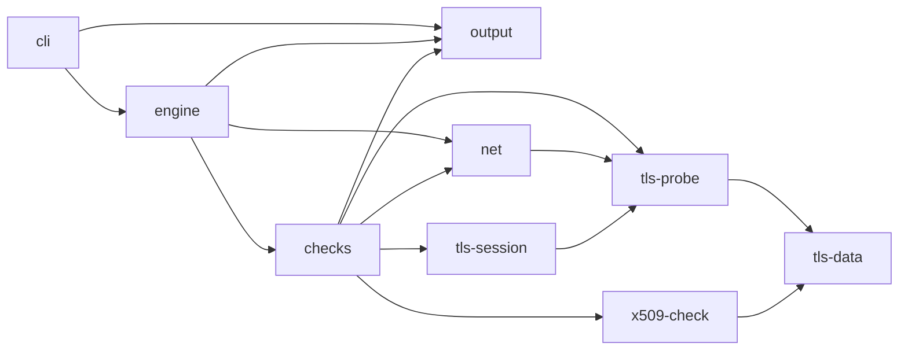

# certscan

[](https://github.com/MRX7999/rust-cert-scan/actions/workflows/ci.yml)
[](LICENSE)


`certscan` is a TLS and certificate configuration scanner in Rust, a result-level port of [testssl.sh](https://github.com/testssl/testssl.sh). Output is JSON and NDJSON only. There is no colored terminal report and no dependency on an external `openssl` binary.

The binary does not scan yet. It prints its version and refuses any other argument, so a downloaded archive cannot look like a successful run.

## Authorized use only

The scanner is built to open many connections and to send non-standard TLS messages. Some vulnerability checks, once implemented, are active. Use it only on systems you own, or on systems whose owner has given you explicit written permission.

Scanning systems you do not own, without permission, may be illegal. This repository does not provide instructions for bypassing access controls, IDS evasion, or attacking third-party hosts.

## Status

Early development. Phase 0 (workspace, lints, CI, fuzz harness, local stands) is done. Phase 1 is in progress: the wire codec, connector, limits and target stream exist. The check registry, JSON writers, X.509 validation, the TLS session and the scheduler do not.

| Area | State |
|---|---|
| `tls-data` | IANA snapshots and the testssl.sh cipher map |
| `tls-probe` | Sans-I/O codec, ClientHello, ServerHello, Certificate, ServerKeyExchange, SSLv2 |
| `net` | TCP connector, DNS cache, probe exchange, timeouts |
| `engine` | Connection limits, backoff, circuit breaker, target stream |
| `checks`, `output`, `x509-check`, `tls-session` | Skeletons |
| `certscan` CLI | Version and help only. Scanning is not implemented |

A longer map of what is and is not in the tree is in [docs/README.md](docs/README.md). The design record, plan and decision log are maintained in Russian.

## Platforms

CI tests, builds a release binary, smoke-tests it and uploads an archive for each row below. A tag `v*` also builds macOS x86_64 and publishes a GitHub Release. Decision D-06.

| Platform | Target | CI | Release |
|---|---|---|---|
| Linux x86_64 glibc | `x86_64-unknown-linux-gnu` | yes | yes |
| Linux x86_64 musl | `x86_64-unknown-linux-musl` | yes | yes |
| Linux arm64 glibc | `aarch64-unknown-linux-gnu` | yes | yes |
| macOS arm64 | `aarch64-apple-darwin` | yes | yes |
| macOS x86_64 | `x86_64-apple-darwin` | cross-built on release only | yes |
| Windows x86_64 | `x86_64-pc-windows-msvc` | yes | yes |

Release profile: fat LTO, one codegen unit, `panic = abort`, symbols stripped. Archives are `tar.gz` on Unix and `zip` on Windows. Each archive contains the binary, `LICENSE`, `README.md`, `SECURITY.md` and `NOTICE-testssl.md`, plus a `.sha256` file. CI keeps artifacts for 14 days and publishes a combined `SHA256SUMS`.

There is no install script and no crates.io publish (`publish = false`). Build from source, or take an archive from a [workflow run](https://github.com/MRX7999/rust-cert-scan/actions/workflows/ci.yml) or a [release](https://github.com/MRX7999/rust-cert-scan/releases) once one exists.

## Build

Stable Rust 1.96 or newer. `rust-toolchain.toml` selects stable with rustfmt and clippy. `rust-version` in `Cargo.toml` is 1.96. Edition 2024.

```sh
cargo build --workspace --locked
cargo run -p cli -- --version
cargo build --release --locked -p cli
# binary: target/release/certscan
```

```text
$ certscan --version
certscan 0.1.0

$ certscan example.com
certscan: scanning is not implemented; this build does not open connections
```

Exit code 0 for version and help. Exit code 2 for anything else.

Checks before a commit:

```sh
cargo fmt --all -- --check
cargo clippy --workspace --all-targets --locked -- -D warnings
cargo test --workspace --locked
cargo deny check
```

`cargo deny` and `cargo audit` are not part of the workspace. Install them with `cargo install cargo-deny cargo-audit`, or let CI install them.

`cargo xtask --help` lists development commands. The help text is Russian, matching the rest of the development tooling. `ci` runs fmt, clippy and test. `update-data` refreshes the IANA snapshots (needs `curl` and a network). `record-fixture` records a loopback fixture. `fuzz-seeds` rebuilds the fuzz seed set. `schema` is declared and not implemented.

Fuzzing lives in `fuzz/` (a separate nightly workspace). See [fuzz/README.md](fuzz/README.md).

Local stands listen only on `127.0.0.1`. See [tests/README.md](tests/README.md).

## Layout

```text
crates/tls-data     IANA tables and the testssl.sh cipher map
crates/tls-probe    TLS wire format, no I/O
crates/tls-session  TLS 1.3 key schedule and TLS 1.0–1.2 handshake
crates/net          connector: TCP, DNS cache, timeouts
crates/x509-check   certificates, chains, trust stores, OCSP/CRL
crates/checks       checks and the shared trait
crates/engine       targets, scheduler, limits, backoff, checkpoint
crates/output       result types, JSON and NDJSON
crates/cli          certscan binary
xtask               development commands
fuzz                cargo-fuzz targets
tests/stands        loopback OpenSSL stand
```



## Documentation

| Document | Language | What it is |
|---|---|---|
| [docs/README.md](docs/README.md) | English | Status, CI artifacts, where to read next |
| [SECURITY.md](SECURITY.md) | English | Authorized use and how to report a defect |
| [CONTRIBUTING.md](CONTRIBUTING.md) | English | Build, test and review bar |
| [docs/ARCHITECTURE.md](docs/ARCHITECTURE.md) | Russian | Design record |
| [docs/PLAN.md](docs/PLAN.md) | Russian | Task plan |
| [docs/DECISIONS.md](docs/DECISIONS.md) | Russian | Decision log. On conflict, this wins |
| [fuzz/README.md](fuzz/README.md) | English | Fuzz targets and seeds |
| [tests/README.md](tests/README.md) | English | Loopback stands |

## License

[GPL-2.0-only](LICENSE).

This project is a derivative work of [testssl.sh](https://github.com/testssl/testssl.sh), which is distributed under GPLv2. The file `etc/cipher-mapping.txt` is stored unchanged at `crates/tls-data/data/testssl/` (decision D-01). Version, commit and sha256 are recorded in [crates/tls-data/data/SOURCES.md](crates/tls-data/data/SOURCES.md). See [NOTICE](crates/tls-data/data/testssl/NOTICE.md).
