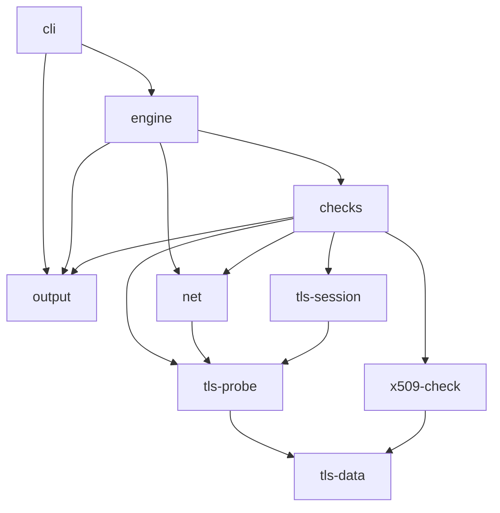
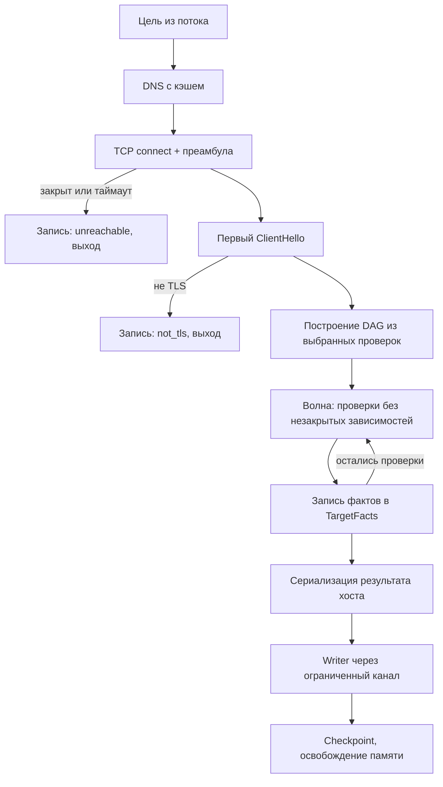

# Rust-Cert-Scan: архитектура

> English status and repository guide: [README.md](README.md). This design record is maintained in Russian.

Статус: идёт реализация по [PLAN.md](PLAN.md): Фаза 0 (каркас workspace и CI) выполнена, в работе Фаза 1.
Имя бинарника: `certscan`, префикс переменных окружения — `CERTSCAN_*` (решение D-02 в [DECISIONS.md](DECISIONS.md)).

## 0. Источники и границы сверки

Сверка с testssl.sh выполнена 2026-11-11 по трём источникам:

| Источник | Что получено | Ограничение |
|---|---|---|
| `doc/testssl.1.md`, ветка 3.2 | порядок default run (10 секций), входные параметры, `--file`/nmap `-oG`, `--mx`, `--ip`, `--proxy`, `-6`, `--nodns`, `--sneaky`, `--ids-friendly`, `--phone-out`, `--add-ca`, `--mtls`, список STARTTLS-протоколов | текст обрезан на разделе SINGLE CHECK OPTIONS |
| `--help` на testssl.sh (3.3dev) | флаги одиночных проверок и уязвимостей, включая `--OP/--opossum`, `--SI/--starttls-injection`, QUIC/HTTP/3 в `-p`, `--socket-timeout` | текст обрезан на `--rc4` |
| `--help` пакета Kali (3.2.4) | полный список: single check, уязвимости, tuning, output, file output | версия 3.2.4, без новшеств 3.3dev |

Не сверено (обрезка источников), помечено в тексте как «не сверено»:

- коды возврата testssl.sh (раздел EXIT STATUS man-страницы);
- точная структура `--jsonfile-pretty` и полный список `id` находок;
- внутренние переменные тюнинга (`USLEEP_SND`, `USLEEP_REC`, `MAX_WAITSOCK` упомянуты в man, значения не проверялись);
- версии крейтов: ни одна не проверялась, поэтому все крейты указаны без версий.

Базовая линия совместимости: флаги и проверки 3.2.x; из 3.3dev берутся QUIC, Opossum и переименование таймаута.

## 1. Цели и не-цели

Цели:

- покрыть проверки testssl.sh на уровне результата (не на уровне экранного вывода);
- вывод только в JSON/NDJSON;
- массовые сканы с жёсткими лимитами на соединения, скорость и память;
- минимум соединений на хост за счёт общего кэша фактов;
- сканирование только собственных и авторизованных систем; агрессивные проверки отключаются одним флагом.

Не-цели: цветной экранный отчёт, HTML/CSV-вывод, зависимость от внешнего бинарника `openssl`, обход IDS.

## 2. Матрица покрытия функциональности testssl.sh

Способы реализации:

- `probe` — ручной ClientHello и разбор ответа до конца открытой части handshake (крейт `tls-probe`), криптография не нужна;
- `session13` — собственный key schedule TLS 1.3 для расшифровки EncryptedExtensions/Certificate (крейт `tls-session`);
- `session12` — собственный полный handshake TLS 1.0–1.2 (крейт `tls-session`);
- `derive` — вывод из кэша фактов без новых соединений;
- `http` — запрос HTTP/1.1 поверх `session12`/`session13`;
- `ext` — обращение к сторонним узлам (только при `--phone-out`).

### 2.1 Протоколы

| Проверка | Флаг testssl.sh | Реализация | Фаза |
|---|---|---|---|
| SSLv2 | `-p` | `probe`: SSLv2 CLIENT-HELLO (2-байтовый заголовок record), разбор SERVER-HELLO со списком cipher kinds и сертификатом | 1 |
| SSLv3 | `-p` | `probe`: record version 0x0300, без расширений | 1 |
| TLS 1.0, 1.1, 1.2 | `-p` | `probe`: по одному ClientHello на версию, полный набор suites | 1 |
| TLS 1.3 (и драфты) | `-p` | `probe`: `supported_versions` + `key_share`; обработка HelloRetryRequest | 1 |
| ALPN | `-p` | `probe`: по одному ClientHello на предлагаемый протокол (h2, http/1.1) | 1 |
| NPN/SPDY | `-p` | `probe`: расширение next_protocol_negotiation, список из ServerHello | 3 |
| QUIC / HTTP/3 | `-p` (3.3dev) | `probe` + UDP: QUIC v1 Initial с ClientHello, ключи Initial выводятся из DCID; дешёвый индикатор — заголовок `Alt-Svc` | 4 (feature `quic`) |
| Определение сервиса (HTTP или нет) | секция 0 | `http`/`derive`: первый ответ после handshake | 3 |

### 2.2 Шифры

| Проверка | Флаг | Реализация | Фаза |
|---|---|---|---|
| Перечисление шифров по протоколам | `-E` | `probe`: пакетный перебор с исключением выбранного suite (раздел 6.3) | 1 |
| Проверка каждого шифра | `-e` | `derive` из перечисления по протоколам | 1 |
| Категории (NULL, anon, export, LOW, 3DES/IDEA, CBC, AEAD) | `-s` | `derive`: классификация по таблице `tls-data` | 1 |
| Cipher order и server preference | `-P` | `probe`: два ClientHello с прямым и обратным порядком на протокол; порядок сервера получается из перебора с исключением | 1 |
| Одиночный шифр по шаблону | `-x` | `probe`: фильтр по hex/имени, один ClientHello | 1 |
| Имена OpenSSL и IANA | `--mapping` | таблица `tls-data`, опция `--cipher-names` | 1 |

### 2.3 Forward secrecy, группы, DH

| Проверка | Флаг | Реализация | Фаза |
|---|---|---|---|
| FS-шифры | `-f` | `derive` из перечисления | 1 |
| Группы/кривые TLS 1.2 | `-f` | `probe`: перебор `supported_groups` с исключением, группа читается из ServerKeyExchange | 1 |
| Группы TLS 1.3 (включая гибридные KEM) | `-f` | `probe`: перебор через `key_share`/HRR; для неизвестных групп достаточно HRR, key share не вычисляется | 1 |
| DH-параметры: размер, известные простые | `-f`, `-J` | `probe`: p и g из ServerKeyExchange; сравнение со списком известных простых (RFC 7919, RFC 3526 и др.) | 1 (размер), 2 (известные простые) |
| Алгоритмы подписи в ServerKeyExchange | `-f` | `probe`: перебор `signature_algorithms` | 3 |

### 2.4 Server defaults

| Проверка | Флаг | Реализация | Фаза |
|---|---|---|---|
| Расширения ServerHello | `-S` | `probe` (TLS ≤1.2), `session13` (EncryptedExtensions) | 1 |
| Session ticket: наличие, lifetime hint | `-S` | `session12`: NewSessionTicket после Finished; `session13`: post-handshake сообщение | 2 |
| Resumption по ID и по ticket | `-S` | `session12`: повторный handshake с сохранённым состоянием | 2 |
| OCSP stapling | `-S` | `probe`: `status_request`, CertificateStatus; для TLS 1.3 — `session13` | 1 |
| Клок-скью | `-S` | `derive`: `gmt_unix_time` из ServerHello.random (TLS ≤1.2), иначе заголовок `Date` | 1 / 3 |
| Сжатие TLS | `-S`, `-C` | `probe`: compression method в ServerHello | 2 |
| Heartbeat-расширение | `-S` | `derive` из расширений | 1 |
| TLS 1.3 0-RTT (early data) | 3.3dev | `session13`: `early_data` в NewSessionTicket | 4 |
| GREASE и ограничения размера ClientHello | `-g` | `probe`: ClientHello с GREASE-значениями, длинные hello (>255, >512 байт) | 4 |

### 2.5 Сертификаты

| Проверка | Реализация | Фаза |
|---|---|---|
| Получение цепочки | `probe` (TLS ≤1.2: Certificate идёт открытым текстом), `session13` (TLS 1.3) | 1 |
| Несколько сертификатов: RSA/ECDSA/EdDSA | `probe`: ClientHello с suites и `signature_algorithms` только под один тип ключа | 1 |
| Сертификат с SNI и без SNI | `probe`: два запроса, сравнение отпечатков | 1 |
| Trust stores | собственный построитель пути: Mozilla по умолчанию, `--add-ca`, каталог дополнительных хранилищ (Apple/Java/Linux/Microsoft — см. раздел 10) | 1 |
| Порядок и полнота цепочки | `derive` из разбора цепочки | 1 |
| SAN, CN, соответствие имени, wildcard | разбор X.509 | 1 |
| Сроки действия, остаток дней, общий срок | разбор X.509 | 1 |
| Алгоритм подписи, тип и размер ключа | разбор X.509 | 1 |
| Отпечатки, серийный номер, EKU, Key Usage | разбор X.509 | 1 |
| Certificate Transparency | SCT из расширения сертификата, из TLS-расширения, из OCSP-ответа | 1 (сертификат), 3 (остальное) |
| OCSP must-staple | расширение TLS Feature в сертификате + факт stapling | 1 |
| Разбор stapled OCSP | статус, thisUpdate/nextUpdate, проверка подписи ответа | 3 |
| Отзыв через OCSP/CRL | `ext`: минимальный HTTP/1.1-клиент без TLS, лимит размера CRL | 3 |
| DNS CAA | DNS-запрос через резолвер | 3 |
| Клиентский сертификат (mTLS) | `--mtls` в testssl.sh; фиксируется факт CertificateRequest, сам mTLS — отложено | 1 (факт), отложено (mTLS) |

### 2.6 HTTP-заголовки

Все проверки группы — один GET `/` поверх полного handshake (`http`), Фаза 3.

| Проверка | Реализация |
|---|---|
| HTTP status, redirect | разбор строки статуса и `Location` |
| HSTS: max-age, includeSubDomains, preload | разбор `Strict-Transport-Security` |
| HPKP | разбор `Public-Key-Pins`, сверка пинов с цепочкой |
| Cookies: Secure, HttpOnly, SameSite | разбор `Set-Cookie` |
| Security headers: X-Frame-Options, X-Content-Type-Options, CSP, Referrer-Policy, Permissions-Policy, COOP/COEP/CORP и др. | словарь заголовков в `checks` |
| Баннеры: Server, X-Powered-By, признаки reverse proxy | разбор заголовков |
| Утечка внутреннего IPv4 | поиск RFC 1918 адресов в заголовках |
| Время сервера | заголовок `Date` |

### 2.7 Уязвимости

| Проверка | Флаг | Реализация | Соединения | Фаза |
|---|---|---|---|---|
| Heartbleed (CVE-2014-0160) | `-H` | `probe`: heartbeat request с завышенной длиной после ServerHelloDone | 1 | 2 |
| CCS Injection (CVE-2014-0224) | `-I` | `probe`: преждевременный ChangeCipherSpec, анализ alert | 1 | 2 |
| Ticketbleed (CVE-2016-9244) | `-T` | `session12`: получить ticket, затем ClientHello с коротким session ID и сравнить эхо | 2–3 | 2 |
| ROBOT | `--BB` | `probe` + сырой RSA: ClientKeyExchange с несколькими вариантами неверного PKCS#1 v1.5, сравнение реакций | 5–10 | 2 |
| Secure renegotiation | `-R` | `derive`: `renegotiation_info` в ServerHello | 0 | 2 |
| Client-initiated renegotiation | `-R` | `session12`: повторный ClientHello внутри сессии | 1 | 2 |
| CRIME | `-C` | `probe`: предложить DEFLATE | 0–1 | 2 |
| BREACH | `-B` | `http`: `Accept-Encoding`, анализ `Content-Encoding` | 0 (тот же запрос) | 3 |
| POODLE (SSL) | `-O` | `derive`: SSLv3 + CBC | 0 | 2 |
| TLS_FALLBACK_SCSV | `-Z` | `probe`: ClientHello пониженной версии с SCSV | 1 | 2 |
| SWEET32 | `-W` | `derive`: 64-битные блочные шифры | 0 | 2 |
| FREAK | `-F` | `derive`: RSA export suites | 0 | 2 |
| DROWN | `-D` | `derive`: SSLv2 + отпечаток ключа для поиска на других хостах | 0 | 2 |
| LOGJAM | `-J` | `derive`: DHE export + известные простые | 0 | 2 |
| BEAST | `-A` | `derive`: CBC в SSLv3/TLS 1.0 | 0 | 2 |
| LUCKY13 | `-L` | `derive`: CBC suites | 0 | 2 |
| Winshock | `-WS` | `derive`: эвристика по набору шифров, кривых и баннеру; низкая достоверность | 0 | 2 |
| RC4 | `-4` | `derive` | 0 | 2 |
| STARTTLS injection | `--SI` | `probe`: команда, склеенная с STARTTLS в одном сегменте | 1 | 3 |
| Opossum | `--OP` (3.3dev) | plaintext-запрос `Upgrade: TLS/1.0` на порт 80 | 1–2 | 3 |

### 2.8 Симуляция клиентов

| Проверка | Реализация | Фаза |
|---|---|---|
| Согласованные протокол, шифр, группа для каждого клиента | `probe`: записанный ClientHello клиента воспроизводится побайтно, меняются только SNI и random | 3 |
| Офлайн-симуляция | `derive`: если известны полный порядок сервера и группы, результат вычисляется без соединения; режим `--client-sim verify` перепроверяет соединением | 4 |

Данные клиентов — отдельные файлы в `tls-data/data/clients/`; происхождение данных — открытый вопрос (раздел 10).

### 2.9 STARTTLS

Реализуется в крейте `net` как преамбула до TLS, Фаза 3. Список сверен с `--help`.

| Протокол | Преамбула | Примечание |
|---|---|---|
| smtp, lmtp | banner → `EHLO`/`LHLO` → `STARTTLS` | `--mx` перебирает MX по приоритету |
| imap | banner → `a001 STARTTLS` | |
| pop3 | banner → `STLS` | |
| ftp | banner → `AUTH TLS` | |
| nntp | banner → `STARTTLS` | |
| sieve | capabilities → `STARTTLS` | |
| xmpp, xmpp-server | stream header → `<starttls/>` | `--xmpp-host` |
| ldap | ExtendedRequest с OID 1.3.6.1.4.1.1466.20037 | бинарный BER |
| postgres | SSLRequest (8 байт) → ответ `S` | |
| mysql | разбор Initial Handshake → SSLRequest с флагом CLIENT_SSL | |
| telnet | START_TLS option | низкий приоритет |
| irc | `STARTTLS` | в testssl.sh помечен как WIP; отложено |

### 2.10 Вход

| Возможность | Аналог testssl.sh | Реализация | Фаза |
|---|---|---|---|
| Одиночная цель: host, host:port, URL, IPv4, [IPv6] | `<URI>` | парсер целей в `engine` | 1 |
| Файл целей: по одной на строку, комментарии `#` | `--file`, `-iL` | потоковое чтение, без загрузки файла в память | 1 |
| nmap greppable (`-oG`) | `--file` | парсер + таблица «порт → STARTTLS» | 3 |
| CIDR | нет в testssl.sh | ленивое разворачивание диапазона | 1 |
| IPv4/IPv6 | `-6`, `--ip` | `-4`, `-6`, `--ip <addr\|one\|all>` | 1 |
| HTTP CONNECT proxy | `--proxy` | преамбула CONNECT в `net` | 3 |
| SOCKS5 proxy | нет в testssl.sh | расширение, преамбула в `net` | 4 |
| MX-записи | `--mx` | DNS MX → цели с `starttls=smtp` | 3 |

## 3. Ключевое решение: собственный низкоуровневый TLS-пробник

### 3.1 Почему недостаточно rustls или native-tls

| Требование сканера | rustls | native-tls |
|---|---|---|
| SSLv2, SSLv3 | нет и не будет | зависит от системной библиотеки, в современных сборках отключено |
| TLS 1.0, 1.1 | нет | зависит от системной политики |
| export, NULL, anon, RC4, 3DES suites | нет | отключены или отсутствуют |
| Произвольный список suites/групп/расширений в ClientHello | ограничено поддерживаемыми | почти нет контроля |
| Доступ к сырым ServerHello, ServerKeyExchange, alert | нет | нет |
| Намеренно некорректные сообщения (Heartbleed, CCS, ROBOT) | невозможно | невозможно |
| Побайтное воспроизведение чужого ClientHello | невозможно | невозможно |
| Одинаковое поведение на всех ОС | да | нет: SChannel, Secure Transport, OpenSSL ведут себя по-разному |

Вывод: библиотека-клиент отвечает на вопрос «могу ли я соединиться», а сканеру нужен ответ «что сервер ответит на произвольный hello». Большинство проверок из матрицы (протоколы, шифры, группы, сертификаты в TLS ≤1.2, производные уязвимости) завершаются до начала шифрования, им криптография не нужна вовсе.

### 3.2 Крейт tls-probe

- Чистый wire-формат: сборка и разбор байтов, без tokio, без сокетов, без криптографии. Вход — `&[u8]`, выход — заимствующие структуры.
- Сборка: SSLv2 CLIENT-HELLO; TLS record layer; ClientHello с произвольными версией, random, session ID, suites, compression, расширениями (типизированные билдеры плюс «сырое» расширение); ClientKeyExchange, ChangeCipherSpec, Heartbeat, Alert.
- Разбор: SSLv2 SERVER-HELLO; record layer с фрагментацией и склейкой handshake-сообщений; ServerHello, HelloRetryRequest, Certificate, CertificateStatus, ServerKeyExchange (DHE, ECDHE), CertificateRequest, ServerHelloDone, NewSessionTicket, Alert.
- Инкрементальный декодер: `feed(&mut &[u8]) -> Result<Event<'_>, ParseError>` (вход сдвигается на забранные байты; «нужно больше данных» — событие `Event::NeedMore`); I/O выполняет вызывающий код. За счёт этого крейт фаззится и тестируется на байтовых фикстурах без сети.
- `#![forbid(unsafe_code)]`, все длины проверяются, лимиты задаются структурой `ParseLimits`.

I/O-обвязка (`net`): tokio `TcpStream`, преамбулы (proxy, STARTTLS), таймауты, учёт соединений.

### 3.3 Где нужен полноценный handshake

| Задача | Почему нельзя без криптографии |
|---|---|
| Сертификат и расширения в TLS 1.3 | всё после ServerHello зашифровано |
| HTTP-заголовки, BREACH, cookies | нужен application data |
| Session ticket, resumption, Ticketbleed | NewSessionTicket приходит после Finished |
| Client-initiated renegotiation | новый ClientHello отправляется внутри сессии |
| 0-RTT | нужен PSK из ticket |

### 3.4 Варианты и сравнение

| Критерий | A: rustls + кастомный verifier | B: крейт openssl, feature vendored | C: собственная реализация на крипто-примитивах |
|---|---|---|---|
| TLS 1.3 certificate | да | да | да |
| TLS 1.2 с ECDHE + AEAD | да | да | да |
| TLS 1.0/1.1, CBC, RSA key exchange | нет | да, при сниженном security level | да, по мере добавления suites |
| SSLv3, RC4, 3DES, export | нет | частично, требует нестандартных флагов сборки | опционально, по необходимости |
| Client-initiated renegotiation | нет | да (TLS ≤1.2) | да |
| Контроль над ClientHello в полном handshake | низкий | средний | полный |
| Ticketbleed, 0-RTT, нестандартные сценарии | нет | ограниченно | да |
| Зависимость от C и системных инструментов сборки | нет | да: компиляция OpenSSL, perl, сложная кросс-компиляция | нет |
| Размер бинарника и время сборки | умеренные | большие | малые |
| Второй TLS-стек рядом с `tls-probe` | да | да | нет, общий record layer |
| Объём собственной работы | малый | средний | большой |
| Риск ошибок в криптографии | низкий | низкий | средний |

### 3.5 Выбор: вариант C

Выбран вариант C — собственный слой сессии `tls-session` поверх готовых крипто-примитивов (RustCrypto), с поэтапным вводом.

Аргументы:

1. Покрытие. Вариант A не соединяется с серверами, у которых только TLS 1.0/1.1, CBC или RSA key exchange. Это именно те хосты, ради которых запускают сканер, и для них пропали бы HTTP-заголовки, tickets и renegotiation.
2. Renegotiation и Ticketbleed в A невозможны, в B ограничены API. Это обязательные проверки из матрицы.
3. Один стек. Record layer, разбор сообщений и таблицы уже есть в `tls-probe`; `tls-session` добавляет только key schedule, шифрование записей и Finished. Вариант A или B означал бы два независимых TLS-стека с разным поведением.
4. Ресурсы и сборка. Нет C-зависимостей: статический бинарник, простая кросс-компиляция, предсказуемое потребление памяти на соединение.
5. Модель угроз. Сканер не защищает секреты: конфиденциальность сессии не является целью. Ошибка в криптографии даёт неверную находку, а не компрометацию. Примитивы (AEAD, HKDF, ECDH, RSA) берутся готовые, самостоятельно пишется только протокольная логика. testssl.sh устроен так же: handshake на сокетах, криптография через вспомогательный `openssl`.

Цена решения и как она ограничивается:

- Объём работ разбит по фазам: `session13` (Фаза 1, только до Certificate/Finished), `session12` (Фаза 2), HTTP поверх сессии (Фаза 3).
- Набор suites для полного handshake минимален: TLS 1.3 — AES-128/256-GCM, ChaCha20-Poly1305; TLS 1.2 — ECDHE/DHE/RSA key exchange с AES-GCM, ChaCha20-Poly1305, AES-CBC-HMAC. 3DES и RC4 добавляются только если останутся хосты, недостижимые иначе.
- Если полный handshake с хостом невозможен, зависящие от него проверки возвращают `not_tested` с причиной, а не ошибку.
- Проверка сертификата сервера в `tls-session` не блокирует сессию: цепочка всегда передаётся в `checks`, подпись CertificateVerify проверяется и её результат становится фактом.
- Корректность подтверждается interop-тестами против openssl, nginx, rustls-сервера и векторами RFC 8448.

Запасной путь: если `session12` окажется непропорционально дорогим, вариант B подключается как необязательная feature `openssl-fallback` только для HTTP-заголовков. По умолчанию выключена.

### 3.6 Крипто-примитивы и разбор X.509

Версии не проверялись. Перед Фазой 0 каждая зависимость проходит `cargo deny` и `cargo audit`.

| Назначение | Кандидаты |
|---|---|
| Хэши, HMAC, HKDF | `sha1`, `sha2`, `md-5`, `hmac`, `hkdf` |
| AEAD и CBC | `aes-gcm`, `chacha20poly1305`, `aes`, `cbc` |
| ECDH | `x25519-dalek`, `p256`, `p384` |
| RSA: шифрование открытым ключом, проверка подписей, сырой modexp для ROBOT | `rsa` (используются только операции с открытым ключом) |
| Подписи | `ecdsa` через `p256`/`p384`, `ed25519-dalek` |
| X.509, OCSP, CRL | `x509-parser` либо `x509-cert` + `der` — выбрать в задаче Фазы 1 по результатам прототипа |
| Корни Mozilla | `webpki-root-certs` либо собственный PEM-снимок в `tls-data` |

Построение цепочки доверия пишется самостоятельно поверх разбора X.509. Готовые верификаторы (`rustls-webpki`) слишком строги для диагностики: они отвергают сертификат на первой ошибке, а сканеру нужен полный список проблем.

### 3.7 Таблицы: крейт tls-data

- Источник cipher suites, групп, расширений, signature schemes и alert: снимки CSV-реестров IANA, сохранённые в репозитории (`crates/tls-data/data/iana/`).
- Дополнения, которых нет в IANA: имена OpenSSL, классификация (kx, auth, enc, mac, биты, категория), SSLv2 cipher kinds, устаревшие и драфтовые suites, GREASE-значения — в собственных файлах `data/extra/*.toml`.
- `build.rs` читает только локальные файлы и генерирует отсортированные `static`-массивы; поиск по коду — бинарный. Сеть во время сборки не используется.
- `phf` применяется только для поиска по имени, если бинарный поиск по отсортированному массиву имён окажется неудобным; обязательной зависимостью не является.
- Обновление снимков — отдельная команда `cargo xtask update-data`, результат попадает в репозиторий обычным коммитом.
- Использование `etc/cipher-mapping.txt` из testssl.sh как источника имён зависит от лицензии проекта (testssl.sh распространяется под GPLv2) — раздел 10.

## 4. Структура cargo workspace

```
Rust-Cert-Scan/
├── Cargo.toml                 # [workspace], общие lints, release-профиль
├── rust-toolchain.toml
├── deny.toml
├── crates/
│   ├── tls-data/              # таблицы IANA и дополнения, build.rs
│   ├── tls-probe/             # wire-формат, без I/O, forbid(unsafe)
│   ├── tls-session/           # key schedule TLS 1.3, handshake TLS 1.0–1.2
│   ├── net/                   # connector: TCP, DNS-кэш, proxy, STARTTLS, таймауты, учёт
│   ├── x509-check/            # разбор сертификатов, цепочки, trust stores, OCSP/CRL
│   ├── checks/                # проверки: модуль на проверку, общий trait
│   ├── engine/                # цели, планировщик, лимиты, backoff, checkpoint
│   ├── output/                # схема, JSON/NDJSON, режим совместимости
│   └── cli/                   # clap, TOML-профили, бинарник
├── fuzz/                      # цели cargo-fuzz для tls-probe и x509-check
├── xtask/                     # update-data, record-fixture (запись фикстур с локального стенда), генерация JSON Schema
├── tests/                     # интеграционные тесты, docker-compose, фикстуры
└── docs/
```

Зависимости между крейтами:



`output` содержит только типы результата и сериализацию, поэтому от него могут зависеть и `checks`, и `engine`.

### 4.1 Trait проверки

Эскиз интерфейса (не реализация):

```rust
pub trait Check: Send + Sync {
    /// id, группа, заголовок, CVE, CWE, признак offensive, пресеты.
    fn meta(&self) -> &'static CheckMeta;
    /// Факты, без которых проверка не запускается.
    fn requires(&self) -> &'static [FactId];
    /// Факты, которые используются, если уже есть, но не обязательны.
    fn wants(&self) -> &'static [FactId];
    /// Факты, которые проверка записывает в кэш.
    fn provides(&self) -> &'static [FactId];
    /// Оценка числа соединений (min, max) с учётом уже известных фактов.
    fn cost(&self, facts: &TargetFacts) -> Cost;
    /// Применима ли проверка: нет TLS, нет нужного протокола, не HTTP и т. п.
    fn applicable(&self, facts: &TargetFacts) -> Applicability;
    /// Выполнение. Соединения открываются только через ctx.connector.
    fn run<'a>(&'a self, ctx: &'a CheckCtx<'a>) -> BoxFuture<'a, CheckOutcome>;
}
```

- `CheckMeta.id` — стабильный идентификатор вида `proto.tls1_2`, `vuln.heartbleed`, `cert.chain`; отдельное поле `testssl_id` для режима совместимости.
- `FactId` — типизированный ключ кэша: `Protocols`, `CiphersByProto`, `ServerOrder`, `Groups`, `DhParams`, `CertChains`, `ServerHelloExts`, `HttpResponse`, `SessionTicket` и т. д.
- `TargetFacts` — кэш фактов на одну цель. Запись делает только проверка, объявившая факт в `provides`; чтение — любая.
- `CheckCtx` даёт доступ к: цели, конфигурации, `TargetFacts`, `Connector` (единственный способ открыть соединение: в нём таймауты и счётчик; уточнение 2026-11-11: разрешение на соединение — семафоры и rate limit, P1-12 — берётся до вызова `Connector::connect`, сам `net::Connector` лимитов не содержит, `docs/DECISIONS.md`, D-17), токену отмены.
- `CheckOutcome` — список `Finding` плюс статус `ok | not_applicable | not_tested | error`.
- Регистрация проверок — статический реестр в `checks::registry()`; планировщик строит DAG по `requires`/`provides`.

### 4.2 Конвейер сканирования одной цели



## 5. Обработка враждебных и некорректных ответов

- Лимиты `ParseLimits`: длина record не более 16384 + 2048 байт; суммарный размер handshake-сообщения (по умолчанию 64 КиБ, для Certificate настраивается); число сертификатов в цепочке; число расширений; общий объём чтения на соединение.
- Три раздельных таймаута (connect, handshake, read) и общий дедлайн на проверку. Медленная «капельная» отдача данных обрывается по общему дедлайну.
- Любая ошибка разбора — значение `ParseError` с позицией, без паники. В release включён `panic=abort`, поэтому отсутствие паник в парсере — требование, подтверждаемое фаззингом.
- Данные сервера никогда не интерпретируются как команды; в JSON попадают после экранирования, бинарные — в hex/base64 с ограничением длины.
- HTTP-ответ: лимит на размер заголовков и тела, тело читается только в объёме, нужном проверке.
- CRL и OCSP (`--phone-out`): лимит размера и времени, без следования редиректам на произвольные схемы.

## 6. Производительность и бережность к ресурсам

### 6.1 Конкурентность и лимиты

| Механизм | Параметр | Значение по умолчанию (предварительное) |
|---|---|---|
| Глобальный семафор соединений | `--max-connections` | 64 |
| Семафор на хост (IP-адрес соединения, D-18) | `--max-connections-per-host` | 2 |
| Семафор параллельных хостов | `--max-hosts` | 16 |
| Rate limit на хост, соединений/с | `--rate-per-host` | 10 |
| Глобальный rate limit, соединений/с | `--rate` | 200 |
| Jitter перед соединением | `--jitter` | 0–50 мс |
| Потоки runtime | `--threads` | min(число ядер, 4) |

Значения подлежат калибровке в Фазе 4. testssl.sh по умолчанию сканирует последовательно, поэтому `--max-connections-per-host 1` даёт сопоставимую нагрузку на цель.

- Runtime: tokio с минимальным набором features (rt, net, time, sync, io-util). Нагрузка I/O-bound, большого пула потоков не требуется.
- Rate limit: token bucket на `tokio::time`, один глобальный и по одному на хост; собственная реализация, чтобы не тянуть лишние зависимости.
- Порядок захвата (уточнение 2026-11-11, P1-12, `docs/DECISIONS.md`, D-19): слот хостов → семафор хоста → rate хоста → глобальный rate → задержка (backoff и jitter) → глобальный семафор. Токены берутся после слота хоста, глобальный слот — последним. Разрешения освобождаются при закрытии сокета. Реализация — `engine::limits::Limiter`; burst по умолчанию — 16 глобально и 2 на хост.

### 6.2 Адаптивный backoff

- Сигналы: RST, таймаут connect, таймаут handshake, обрыв без alert. Обычные TLS alert сигналом не считаются: это штатный ответ на пробник.
- Реакция по схеме AIMD на хост: при сигнале скорость хоста делится на 2 и добавляется экспоненциальная пауза с jitter (до заданного потолка); при серии успешных соединений скорость линейно восстанавливается.
- Circuit breaker: N подряд неуспешных соединений — хост помечается `blocked_or_down`, оставшиеся проверки получают `not_tested`, сканер переходит к следующей цели.
- Глобальный контур: рост доли таймаутов по всем хостам снижает глобальный rate (защита сканирующей машины и канала). Уточнение 2026-11-11 (P1-13): реализована защита по нехватке локальных ресурсов — ошибки «нет дескрипторов» и «нет локальных портов» временно снижают глобальный лимит соединений; снижение rate по доле таймаутов отложено (D-19). Классификация исходов, параметры AIMD и breaker — D-20.

### 6.3 Минимизация числа соединений

1. Ранний выход: закрытый порт или не-TLS ответ — одна попытка, без повторов по всем проверкам.
2. Пакетный перебор шифров: в ClientHello отправляется пакет suites (по умолчанию до 128, чтобы не упираться в ограничения старых стеков на размер hello); выбранный сервером suite исключается, запрос повторяется до отказа. Стоимость на протокол: число поддерживаемых suites + число пакетов. При включённом server preference тот же перебор даёт порядок сервера.
3. Тот же приём для групп и signature algorithms.
4. Кэш фактов: каждый ServerHello разбирается полностью, все поля (расширения, время, session ID, сжатие, сертификаты) сохраняются, даже если текущей проверке нужен только один бит. 10 из 20 проверок уязвимостей выполняются без соединений (`derive`), ещё две (BREACH, CRIME) обычно обходятся уже сделанными запросами.
5. Совмещение: проверка протокола TLS 1.2 одновременно получает сертификат, OCSP staple, расширения и клок-скью; HTTP-запрос для заголовков обслуживает BREACH, cookies и баннеры.
6. Оценка стоимости: планировщик суммирует `cost()` и при `--max-connections-per-target N` отбрасывает самые дорогие проверки из хвоста приоритетов с пометкой `skipped_budget`.
7. Офлайн-симуляция клиентов (Фаза 4).

### 6.4 Оценка числа соединений на полный скан одного хоста

Это оценка, а не измерение. Расчёт сделан для типичного веб-сервера: TLS 1.2 (около 12 suites) и TLS 1.3 (3 suites), 4–5 групп, один-два сертификата. Измерение — задача Фазы 4 (подсчёт SYN через tcpdump для обоих инструментов на одинаковых стендах).

| Блок | certscan `fast` | certscan `default` | certscan `full` |
|---|---|---|---|
| Доступность и определение TLS | 1 | 1 | 1 |
| Протоколы (6 версий) + ALPN/NPN | 3 | 8–9 | 9–10 |
| Перечисление шифров и порядок | 0 | 20–30 | 30–45 |
| Группы, DH | 0 | 8–12 | 10–15 |
| Server defaults, tickets, resumption | 1 | 4–6 | 6–8 |
| Сертификаты (типы ключей, SNI/без SNI, TLS 1.3) | 1–2 | 3–5 | 4–6 |
| HTTP-заголовки | 1 | 1 | 1 |
| Уязвимости | 0 | 12–20 | 15–22 |
| Симуляция клиентов | 0 | 20–30 | 40–60 |
| GREASE, QUIC, 0-RTT | 0 | 0 | 6–10 |
| Итого (оценка) | 8–10 | 80–115 | 120–180 |

Для testssl.sh опубликованных цифр не найдено. Грубая оценка для default run — несколько сотен соединений (порядка 300–600): он тоже использует пакетные ClientHello на сокетах, но заново получает данные в разных секциях и часть шагов выполняет через `openssl s_client`. Достоверность этой оценки низкая; ожидаемый выигрыш в 3–5 раз считать гипотезой до измерения. Основная экономия времени и CPU ожидается не только от числа соединений, но и от отсутствия запуска подпроцессов и от параллельной работы.

### 6.5 Память и CPU

- DNS-кэш с TTL и отрицательным кэшем; один резолв на имя за скан; `--dns none` полностью отключает запросы. Реализация (P1-10): `net::DnsCache` поверх системного резолвера; он TTL не отдаёт, поэтому время жизни записей задаётся конфигурацией, значения по умолчанию — `docs/DECISIONS.md`, D-17.
- Буферы: один переиспользуемый `BytesMut` на соединение с верхней границей; пул буферов на хост. Реализация (P1-11): буфер чтения `net::ProbeSession` — фиксированные 16 КиБ на соединение, без `BytesMut`; пула буферов на хост пока нет (`docs/DECISIONS.md`, D-17).
- Парсер без аллокаций в горячем пути: структуры заимствуют срез входного буфера; владеющие копии создаются только при записи в `TargetFacts`.
- Потоковое чтение целей: файл читается построчно, CIDR разворачивается лениво; в памяти одновременно находятся только активные хосты (не более `--max-hosts`).
- Потоковый вывод: результат хоста сериализуется и уходит в writer через ограниченный канал (backpressure), после чего `TargetFacts` освобождается. Потребление памяти не зависит от длины списка целей.
- Сырые данные в выводе (`raw`) ограничены по размеру; полные дампы — только при `--raw full`.

### 6.6 Release-профиль

```toml
[profile.release]
lto = "fat"
codegen-units = 1
panic = "abort"
strip = true
opt-level = 3
```

`opt-level = "s"` сравнивается с `3` в бенчмарках Фазы 4. Отладочные сборки для расследования падений — отдельный профиль `release-debug` без `strip` и с `panic = "unwind"`.

## 7. Настройка

### 7.1 CLI (clap)

Выбор проверок:

| Опция | Смысл |
|---|---|
| `--preset <fast\|default\|full\|vulns-only\|cert-only>` | стартовый набор |
| `--group <g,...>` | добавить группы: `protocols`, `ciphers`, `fs`, `server-defaults`, `cert`, `http`, `vulns`, `client-sim`, `grease` |
| `--only <id,...>` | выполнить только перечисленные проверки (зависимости добавляются автоматически) |
| `--skip <id,...>` | исключить проверки или группы |
| `--list-checks` | вывести реестр проверок в JSON: id, группа, стоимость, CVE |
| `--ids-friendly` | исключить проверки с признаком offensive |

Пресеты:

| Пресет | Состав |
|---|---|
| `fast` | протоколы (без перебора шифров), сертификат по умолчанию, HSTS |
| `default` | всё из default run testssl.sh, кроме рейтинга |
| `full` | `default` + шифры по протоколам, GREASE, QUIC, полный набор клиентов |
| `vulns-only` | группа `vulns` и её зависимости |
| `cert-only` | группа `cert`, 2–5 соединений |

Порядок применения: пресет → `--group` → `--only` → `--skip`.

Цель и соединение: `--sni <name>`, `--ip <addr|one|all>`, `-4`, `-6`, `--proxy <url>`, `--starttls <proto>`, `--xmpp-host`, `--mx <domain>`, `--targets-file <path>`, `--ca-bundle <path>`, `--add-ca <path,...>`, `--dns <full|min|none>`, `--phone-out`, `--assume-http`, `--user-agent`, `--sneaky`, `--basic-auth`, `--req-header` (повторяемая).

Лимиты и таймауты: опции из раздела 6.1, `--connect-timeout`, `--handshake-timeout`, `--read-timeout`, `--check-timeout`, `--max-connections-per-target`.

Большие списки: `--checkpoint <file>`, `--resume`. Checkpoint — журнал завершённых целей (append-only) и хэш действующей конфигурации; при несовпадении хэша `--resume` требует `--force`.

### 7.2 Конфиг-файл TOML

- Поиск: `--config <path>`, затем `./certscan.toml`, затем `$XDG_CONFIG_HOME/certscan/config.toml`.
- Секции: `[defaults]`, `[limits]`, `[timeouts]`, `[output]`, `[profiles.<name>]`. Профиль выбирается через `--profile <name>` и может наследовать другой (`inherits = "..."`).
- Приоритет, от низшего к высшему: встроенные значения → `[defaults]` → профиль → переменные окружения `CERTSCAN_*` → флаги CLI.
- Неизвестные ключи — ошибка конфигурации (код возврата 2), чтобы опечатки не проходили молча.
- `--print-config` выводит итоговую конфигурацию в JSON с указанием источника каждого значения.

### 7.3 Соответствие флагов testssl.sh

| testssl.sh | certscan | Примечание |
|---|---|---|
| `-p`, `--protocols` | `--group protocols` | |
| `-e`, `--each-cipher` | `--only ciphers.each` | |
| `-E`, `--cipher-per-proto` | `--only ciphers.per-proto` | |
| `-s`, `--categories` | `--only ciphers.categories` | |
| `-P`, `--server-preference` | `--only ciphers.preference` | |
| `-x <pattern>` | `--cipher <pattern>` | |
| `-f`, `--forward-secrecy` | `--group fs` | |
| `-S`, `--server-defaults` | `--group server-defaults,cert` | |
| `-h`, `--headers` | `--group http` | короткий `-h` занят справкой |
| `-c`, `--client-simulation` | `--group client-sim` | |
| `-g`, `--grease` | `--group grease` | |
| `-U`, `--vulnerable` | `--preset vulns-only` или `--group vulns` | |
| `-H`, `-I`, `-T`, `--BB`, `--SI`, `-R`, `-C`, `-B`, `-O`, `-Z`, `-W`, `-A`, `-L`, `-WS`, `-F`, `-J`, `-D`, `-4`, `--OP` | `--only vuln.<name>` | имена: heartbleed, ccs, ticketbleed, robot, starttls-injection, renegotiation, crime, breach, poodle, fallback-scsv, sweet32, beast, lucky13, winshock, freak, logjam, drown, rc4, opossum |
| `-9`, `--full` | `--preset full` | |
| `-t`, `--starttls <proto>` | `--starttls <proto>` | |
| `--xmpphost` | `--xmpp-host` | |
| `--mx` | `--mx` | |
| `--file`, `-iL` | `--targets-file` | формат «одна цель на строку» и nmap `-oG`; строки с произвольными опциями testssl.sh не поддерживаются |
| `--mode`, `--parallel`, `--serial` | `--max-hosts N` | `--max-hosts 1` соответствует serial |
| `--connect-timeout` (3.2), `--socket-timeout` (3.3dev) | `--connect-timeout` | |
| `--openssl-timeout` | `--handshake-timeout`, `--read-timeout` | |
| `--ip <ip\|one\|proxy>` | `--ip <addr\|one\|all>`, `--dns-via-proxy` | |
| `--proxy <host:port\|auto>` | `--proxy <url\|auto>` | |
| `-6` | `-6`, `-4` | |
| `-n`, `--nodns <min\|none>` | `--dns <full\|min\|none>` | |
| `--sneaky`, `--user-agent` | те же | |
| `--ids-friendly` | `--ids-friendly` | пропускает heartbleed, ccs, ticketbleed, robot |
| `--phone-out` | `--phone-out` | |
| `--add-ca` | `--add-ca`, `--ca-bundle` | |
| `--assume-http` | `--assume-http` | |
| `--basicauth`, `--reqheader` | `--basic-auth`, `--req-header` | |
| `--mtls` | отложено | |
| `--json`, `--jsonfile`, `-oj` | `--format testssl-flat -o <file>` | |
| `--json-pretty`, `--jsonfile-pretty`, `-oJ` | `--format testssl-pretty -o <file>` | |
| `--severity <level>` | `--min-severity <level>` | |
| `--append`, `--overwrite` | те же | |
| `--mapping` | `--cipher-names <iana\|openssl\|both>` | |
| `--quiet` | `--quiet` | |
| `--debug <0-6>` | `-v`, `-vv`, `--log-level` | логи только в stderr |
| `--warnings` | нет | интерактивных запросов не бывает |
| `--bugs`, `--ssl-native`, `--openssl` | нет | внешний openssl не используется |
| `--csv`, `--html`, `--log`, `--color`, `--colorblind`, `--wide`, `--show-each`, `--hints`, `--outprefix` | нет | только JSON; преобразование — внешними средствами |
| `--disable-rating` | нет | рейтинг отложен (раздел 9) |

## 8. JSON-вывод

### 8.1 Режимы

| `--format` | Описание |
|---|---|
| `json` | единый документ; пишется потоково: заголовок, элементы массива `targets` по мере готовности, `summary` |
| `ndjson-host` | строка на хост |
| `ndjson-finding` | строка на находку, плюс строки `scan_start` и `scan_end` |
| `testssl-flat` | совместимость с `--jsonfile` |
| `testssl-pretty` | совместимость с `--jsonfile-pretty` |

Дополнительно: `--pretty` / `--compact` (для NDJSON всегда compact), `-o <file>` или stdout, `--raw <none|limited|full>`, `--min-severity`. Логи и прогресс идут только в stderr.

Для больших списков рекомендуется NDJSON: единый документ при аварийном завершении остаётся незакрытым. При SIGINT writer корректно закрывает массив и пишет `summary` с `"interrupted": true`.

### 8.2 Схема (schema_version 1.0)

```json
{
  "schema_version": "1.0",
  "scanner": { "name": "certscan", "version": "x.y.z", "commit": "..." },
  "scan": {
    "id": "uuid",
    "started_at": "RFC 3339",
    "finished_at": "RFC 3339",
    "duration_ms": 0,
    "args": ["..."],
    "preset": "default",
    "profile": "name-or-null",
    "config_hash": "sha256"
  },
  "targets": [
    {
      "target": {
        "input": "example.org:443",
        "host": "example.org",
        "ip": "192.0.2.10",
        "ip_version": 4,
        "port": 443,
        "sni": "example.org",
        "starttls": null,
        "proxy": null,
        "rdns": null,
        "service": "http"
      },
      "status": "completed",
      "started_at": "RFC 3339",
      "duration_ms": 0,
      "connections": 0,
      "results": [
        {
          "id": "vuln.heartbleed",
          "testssl_id": "heartbleed",
          "group": "vulns",
          "title": "Heartbleed",
          "status": "ok",
          "severity": "OK",
          "finding": "not vulnerable",
          "cve": ["CVE-2014-0160"],
          "cwe": ["CWE-119"],
          "raw": {},
          "duration_ms": 0,
          "connections": 1,
          "error": null
        }
      ],
      "errors": []
    }
  ],
  "summary": {
    "targets_total": 0,
    "targets_completed": 0,
    "targets_failed": 0,
    "connections_total": 0,
    "by_severity": { "OK": 0, "INFO": 0, "LOW": 0, "MEDIUM": 0, "HIGH": 0, "CRITICAL": 0 },
    "interrupted": false
  }
}
```

Поля:

- `targets[].status`: `completed | partial | unreachable | not_tls | blocked_or_down | error`.
- `results[].status`: `ok | not_applicable | not_tested | skipped_budget | error`. Статус отделён от severity: «не удалось проверить» не маскируется под `OK` или `INFO`.
- `severity`: `OK | INFO | LOW | MEDIUM | HIGH | CRITICAL`.
- `raw`: структурированные данные проверки (списки suites с hex-кодами, параметры DH, поля сертификата, заголовки), объём задаётся `--raw`.
- `error`: `{ "kind": "timeout | reset | parse | unsupported | internal", "message": "..." }`.
- NDJSON-строки несут поле `"type"`: `scan_start`, `host`, `finding`, `scan_end`; в `finding` добавлены `scan_id` и сокращённый `target`.

JSON Schema генерируется из типов крейта `output` командой `cargo xtask schema` и хранится в `docs/schema/`.

### 8.3 Режим совместимости с testssl.sh

- Плоский формат: массив объектов с полями `id`, `ip`, `port`, `severity`, `finding` и необязательными `cve`, `cwe`, `hint`.
- Pretty-формат: документ с метаданными запуска и массивом `scanResult`, где находки сгруппированы по секциям.
- Отображение `id → testssl_id` хранится в `CheckMeta`. Статусы `not_tested` и `error` отображаются в severity `WARN`.
- Точные имена полей верхнего уровня, названия секций и полный список `id` не сверены (раздел 0). Эталон снимается с реального вывода testssl.sh 3.2.x в Фазе 4 и фиксируется golden-файлами. Гарантия совместимости: ключи и типы; тексты `finding` побайтно не совпадают.

### 8.4 Версионирование схемы

- `schema_version` в формате `MAJOR.MINOR`. Добавление полей и новых значений `id` — MINOR; удаление, переименование или смена типа — MAJOR.
- Потребители обязаны игнорировать неизвестные поля.
- `id` проверок стабильны; переименование допускается только со сменой MAJOR.

### 8.5 Коды возврата

| Код | Значение |
|---|---|
| 0 | скан завершён, находок с severity не ниже `--fail-on` нет |
| 1 | есть находки с severity не ниже `--fail-on` (по умолчанию порог выключен) |
| 2 | ошибка аргументов или конфигурации |
| 3 | скан завершён частично: у части целей ошибки или `not_tested` |
| 4 | ни одна цель не достигнута |
| 5 | ошибка записи вывода |
| 130 | прерывание по SIGINT, checkpoint сохранён |

Коды возврата testssl.sh не сверены, совместимость по кодам не заявляется.

## 9. Тестирование и безопасность

| Уровень | Что | Где |
|---|---|---|
| Unit | разбор и сборка сообщений на записанных байтовых фикстурах (hex-файлы); round-trip «собрал → разобрал» | `tls-probe/tests/fixtures/` |
| Unit | key schedule на тестовых векторах RFC 8448; PRF TLS 1.2 на известных векторах | `tls-session` |
| Unit | разбор сертификатов и построение цепочек на наборе тестовых PKI | `x509-check` |
| Property | случайные входы для билдеров, инварианты длины | `tls-probe` |
| Fuzz | `cargo-fuzz`: record layer, ServerHello, Certificate, ServerKeyExchange, SSLv2, X.509, HTTP-заголовки, STARTTLS-парсеры | `fuzz/` |
| Интеграция | `openssl s_server` с разными наборами параметров; docker-образы с намеренно уязвимыми конфигурациями (старые OpenSSL, включённые SSLv2/SSLv3, export, сжатие); локальный набор «badssl-подобных» виртуальных хостов | `tests/` + docker-compose |
| Интеграция | STARTTLS: postfix, dovecot, vsftpd, openldap, postgres, mysql в контейнерах | `tests/` |
| Сверка | сравнение находок с testssl.sh на тех же стендах; расхождения разбираются вручную | `tests/compare/` |
| Бенчмарки | время, CPU, пиковая память, число соединений против testssl.sh; микробенчмарки парсера | `benches/` |
| Лимиты | тесты семафоров, rate limit и backoff на управляемом времени tokio; тест «10^5 целей — память не растёт» | `engine` |

Требования безопасности:

- `unsafe_code = "forbid"` на весь workspace через `[workspace.lints.rust]`; точечное исключение — только отдельным решением с переводом конкретного крейта на собственный блок `[lints]` (решение D-10 в [DECISIONS.md](DECISIONS.md)).
- `clippy -D warnings`, запрет `unwrap`/`expect`/индексации без проверки в парсерах через lints.
- `cargo deny` (лицензии, advisories, дубликаты), `cargo audit` в CI.
- Интеграционные тесты ходят только на локальные стенды; обращения к внешним хостам в CI запрещены.
- Агрессивные проверки помечены `offensive = true` и отключаются `--ids-friendly`; в выводе всегда указано, какие проверки выполнялись.
- Docker-образы с уязвимыми конфигурациями запускаются только в изолированной сети тестового стенда.

## 10. Риски, ограничения и открытые вопросы

### 10.1 Что не переносится 1:1

| Область | Ограничение |
|---|---|
| Экранный вывод, цвета, HTML, CSV, лог-файлы | не переносится, только JSON |
| Рейтинг (секция 10 default run, методика SSL Labs) | отложено; находок достаточно для внешнего расчёта |
| `--ssl-native`, `--openssl`, `--bugs` | не имеют смысла без внешнего openssl |
| Формат `--file` с произвольными строками опций testssl.sh | не поддерживается; только список целей и nmap `-oG` |
| Тексты `finding` | собственные формулировки, совпадение с testssl.sh не гарантируется |
| Winshock | эвристика с низкой достоверностью, как и в оригинале |
| Trust stores Apple, Java, Linux, Microsoft | в комплекте только Mozilla; остальные подключаются пользователем |
| Обход IDS (`USLEEP_SND`, `USLEEP_REC`) | не реализуется; есть только rate limit и jitter как средство бережного сканирования |

### 10.2 Отложено

- mTLS (`--mtls`), IRC STARTTLS, telnet STARTTLS;
- QUIC, 0-RTT, GREASE — Фаза 4, QUIC под feature;
- SOCKS5 и прокси с аутентификацией;
- полный handshake с 3DES/RC4/SSLv3 — по факту необходимости;
- офлайн-симуляция клиентов — Фаза 4;
- постквантовые группы: перечисление через HRR в Фазе 1, полный handshake с ними — отложен.

### 10.3 Риски

| Риск | Влияние | Смягчение |
|---|---|---|
| Объём `tls-session` (вариант C) | сдвиг Фаз 2–3 | минимальный набор suites; feature `openssl-fallback` как запасной путь |
| Ошибки собственной криптографической логики | ложные находки | векторы RFC, interop-тесты, сверка с testssl.sh |
| Ложноположительные и ложноотрицательные результаты в проверках уязвимостей | доверие к инструменту | стенды с известным состоянием, поле `raw` с доказательствами, статус `not_tested` вместо догадок |
| Нестандартные серверы (обрыв на больших ClientHello, нетерпимость к расширениям) | неполное перечисление | размер пакета настраивается, автоматическое уменьшение пакета при обрыве |
| Срабатывание IDS/WAF и блокировка сканирующего IP | неполный скан | backoff, circuit breaker, `--ids-friendly`, статус `blocked_or_down` |
| Устаревание снимков IANA и данных клиентов | неизвестные suites и клиенты | `cargo xtask update-data`, неизвестные коды выводятся как hex |
| Лицензия данных testssl.sh (GPLv2) | ограничение на заимствование mapping-файлов и client-simulation | решение пользователя по лицензии проекта |
| Оценка числа соединений не подтверждена измерением | неверные ожидания по скорости | измерение в Фазе 4 до публикации цифр |

### 10.4 Открытые вопросы для пользователя

Статус: закрыто 2026-11-11. Решения по всем вопросам 1–8 зафиксированы в [DECISIONS.md](DECISIONS.md) (D-01 – D-08); список ниже сохранён как исходная формулировка вопросов.

1. Лицензия проекта. GPLv2-совместимая лицензия позволяет взять `cipher-mapping.txt`, `client-simulation.txt`, списки простых и trust stores из testssl.sh; иначе эти данные собираются заново из IANA, документации OpenSSL и собственных записей ClientHello.
2. Имя бинарника и префикс переменных окружения (в документе `certscan`, `CERTSCAN_*`).
3. Подтверждение варианта C для полного handshake и допустимость feature `openssl-fallback`.
4. Значения лимитов по умолчанию: консервативные (1 соединение на хост, как у testssl.sh) или предложенные (2 на хост, 16 хостов).
5. Какие trust stores, кроме Mozilla, нужны в комплекте.
6. Целевые платформы CI и релизов: macOS arm64 и Linux x86_64 обязательны; нужны ли Linux arm64, musl, Windows.
7. Нужен ли QUIC в принципе или достаточно индикации по `Alt-Svc`.
8. Нужен ли рейтинг в стиле SSL Labs в какой-либо фазе.
