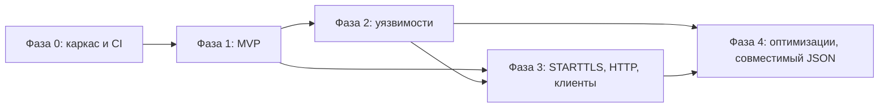
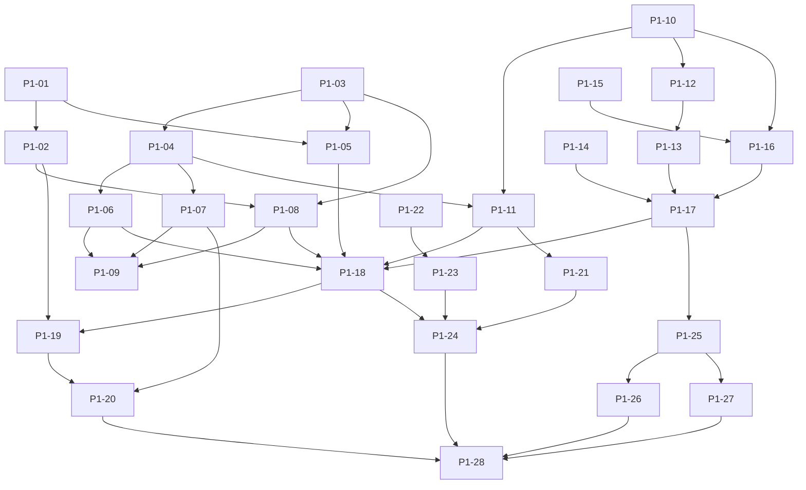

# Rust-Cert-Scan: план реализации

> English status and repository guide: [README.md](README.md). This plan is maintained in Russian.

План опирается на `docs/ARCHITECTURE.md` (далее — ARCH). Каждая задача рассчитана на одного исполнителя в режиме code и не требует знания соседних задач сверх указанных зависимостей.

Соглашения:

- идентификатор задачи: `P<фаза>-<номер>`;
- пути указаны от корня репозитория;
- рабочее имя бинарника — `certscan`, пакет CLI — `cli` (ARCH, раздел 10.4, вопрос 2);
- версии крейтов исполнитель берёт актуальные на момент задачи и фиксирует в `Cargo.lock`; каждая новая зависимость проходит `cargo deny check`;
- интеграционные тесты, которым нужен docker или `openssl`, помечаются `#[ignore]` и запускаются отдельной командой;
- сетевые обращения в тестах — только на `127.0.0.1` и в сеть docker-compose.

Допущение: CI — GitHub Actions. Если хостинг другой, меняется только задача P0-02.

Общие критерии приёмки для любой задачи:

- `cargo fmt --all -- --check`, `cargo clippy --workspace --all-targets -- -D warnings`, `cargo test --workspace` проходят;
- в парсерах нет `unwrap`, `expect`, `panic!` и индексации без проверки;
- публичные типы и функции имеют doc-комментарии;
- новые проверки зарегистрированы в реестре и видны в `--list-checks`.

Граф фаз:



Перед стартом Фазы 0 нужны решения по вопросам 1–3 и 6 из ARCH 10.4 (лицензия, имя, вариант полного handshake, платформы).

***

## Фаза 0. Каркас workspace и CI

Результат: пустой, но собирающийся workspace со всеми крейтами, линтами, CI и заготовками для фаззинга и стендов.

### P0-01. Корень workspace и скелеты крейтов

- Файлы: `Cargo.toml`, `rust-toolchain.toml`, `.gitignore`, `rustfmt.toml`, `crates/{tls-data,tls-probe,tls-session,net,x509-check,checks,engine,output,cli}/Cargo.toml`, `crates/*/src/lib.rs`, `crates/cli/src/main.rs`.
- Вход: ARCH, разделы 4 и 6.6.
- Выход: workspace с 9 крейтами; зависимости между ними заданы по графу из ARCH 4; `[workspace.lints]` и `[profile.release]`, `[profile.release-debug]` заданы в корне.
- Приёмка: `cargo build --workspace` проходит; `unsafe_code = "forbid"` действует на весь workspace через `[workspace.lints.rust]`, исключения — только отдельным решением (D-10 в `docs/DECISIONS.md`); `cargo run -p cli -- --version` печатает версию.
- Зависит от: нет.

### P0-02. CI

- Файлы: `.github/workflows/ci.yml`.
- Вход: P0-01; список платформ (ARCH 10.4, вопрос 6).
- Выход: задания fmt, clippy, test, build release на согласованных платформах; кэш сборки.
- Приёмка: pipeline зелёный на пустом workspace; падает при предупреждении clippy.
- Зависит от: P0-01.

### P0-03. Контроль зависимостей

- Файлы: `deny.toml`, дополнение `.github/workflows/ci.yml`.
- Вход: выбранная лицензия проекта (ARCH 10.4, вопрос 1).
- Выход: `cargo deny check` (advisories, licenses, bans, sources) и `cargo audit` как отдельное задание CI.
- Приёмка: задание проходит; добавление зависимости с запрещённой лицензией роняет CI (проверить вручную один раз).
- Зависит от: P0-01, P0-02.

### P0-04. Заготовка фаззинга

- Файлы: `fuzz/Cargo.toml`, `fuzz/fuzz_targets/record_layer.rs` (заглушка, вызывающая пустую функцию `tls-probe`), `fuzz/README.md`.
- Вход: P0-01.
- Выход: рабочая конфигурация cargo-fuzz, исключённая из основного workspace.
- Приёмка: `cargo +nightly fuzz build` проходит; README описывает запуск и хранение корпуса.
- Зависит от: P0-01.

### P0-05. xtask

- Файлы: `xtask/Cargo.toml`, `xtask/src/main.rs`, `.cargo/config.toml` (alias `xtask`).
- Вход: P0-01.
- Выход: подкоманды `update-data` и `schema` как заглушки с понятным сообщением «не реализовано».
- Приёмка: `cargo xtask --help` показывает обе подкоманды.
- Зависит от: P0-01.

### P0-06. Инфраструктура тестовых стендов и фикстур

- Файлы: `tests/README.md`, `tests/fixtures/README.md`, `tests/docker-compose.yml`, `tests/stands/openssl-basic/` (скрипт генерации тестового сертификата и запуск `openssl s_server`).
- Вход: ARCH, раздел 9.
- Выход: описан формат байтовых фикстур (hex-файл + `.meta.toml` с описанием источника); один стенд TLS 1.2/1.3 на `127.0.0.1:4433`.
- Приёмка: `docker compose -f tests/docker-compose.yml up -d openssl-basic` поднимает стенд, `openssl s_client -connect 127.0.0.1:4433` соединяется.
- Зависит от: нет.

### Команды проверки Фазы 0

```sh
cargo fmt --all -- --check
cargo build --workspace
cargo test --workspace
cargo clippy --workspace --all-targets -- -D warnings
cargo deny check
cargo xtask --help
cargo run -p cli -- --version
```

***

## Фаза 1. MVP

Результат: `certscan` сканирует одиночную цель, файл целей и CIDR; определяет протоколы, шифры, группы, сертификаты; пишет JSON и NDJSON; соблюдает лимиты.

### Данные и wire-формат

#### P1-01. tls-data: снимки IANA и генерация таблиц

- Файлы: `crates/tls-data/data/iana/*.csv`, `crates/tls-data/build.rs`, `crates/tls-data/src/{lib.rs,cipher.rs,group.rs,extension.rs,sigscheme.rs,alert.rs}`, `xtask/src/update_data.rs`.
- Вход: реестры IANA TLS Parameters (cipher suites, supported groups, extension types, signature schemes, alerts).
- Выход: `static` отсортированные таблицы; функции поиска по коду и по имени; `cargo xtask update-data` обновляет снимки.
- Приёмка: `build.rs` не обращается к сети; тесты: поиск известных кодов (`0x1301`, `0xC02F`, группа 29), неизвестный код возвращает `None`; таблицы отсортированы (тест).
- Зависит от: P0-01, P0-05.

#### P1-02. tls-data: дополнения

- Файлы: `crates/tls-data/data/testssl/{cipher-mapping.txt,NOTICE.md}`, дополнение `build.rs`, `crates/tls-data/src/{classify.rs,sslv2.rs}`.
- Уточнение (2026-11-11): дополнения берутся из `crates/tls-data/data/testssl/cipher-mapping.txt` (testssl.sh, тег v3.2.5), каталога `data/extra/*.toml` нет; значения GREASE берутся из снимков IANA (P1-01). Группа стойкости шифров (LOW и подобные) и классификация suites, которые есть только в IANA, перенесены в P1-19.
- Вход: P1-01; решение по лицензии (источник имён OpenSSL).
- Выход: для каждого suite — имя OpenSSL, kx, auth, enc, mac, биты, категория (NULL, anon, export, LOW, 3DES/IDEA, CBC, AEAD), признак FS; таблица SSLv2 cipher kinds; файл `data/SOURCES.md` с происхождением данных.
- Приёмка: тест: у каждого suite из IANA есть классификация либо он явно помечен `unclassified`; тесты категорий на 10 контрольных suites.
- Зависит от: P1-01.

#### P1-03. tls-probe: примитивы кодека

- Файлы: `crates/tls-probe/src/{codec.rs,error.rs,limits.rs}`.
- Вход: ARCH 3.2, 5.
- Выход: `Reader` над `&[u8]` (u8, u16, u24, векторы с префиксом длины), `Writer` над `BytesMut`, `ParseError` с позицией, `ParseLimits` со значениями по умолчанию.
- Приёмка: unit-тесты граничных случаев (пустой вход, усечённая длина, длина больше остатка, превышение лимита); нет аллокаций в `Reader` (проверяется сигнатурами: только заимствования).
- Зависит от: P0-01.

#### P1-04. tls-probe: record layer и инкрементальный декодер

- Файлы: `crates/tls-probe/src/{record.rs,decoder.rs}`.
- Вход: P1-03.
- Выход: разбор и сборка TLS record; `Decoder::feed(&mut &[u8]) -> Result<Event<'_>, ParseError>` (вход сдвигается на забранные байты) с событиями `Handshake`, `Alert`, `ChangeCipherSpec`, `ApplicationData`, `Opaque` (запись, которую декодер не интерпретирует, в том числе любая запись после ChangeCipherSpec), `NeedMore`; склейка handshake-сообщений, разбитых на несколько record.
- Приёмка: тесты: сообщение в одном record, сообщение в трёх record, два сообщения в одном record, подача по одному байту; превышение лимита даёт `ParseError`, не панику.
- Зависит от: P1-03.

#### P1-05. tls-probe: сборка ClientHello

- Файлы: `crates/tls-probe/src/client_hello.rs`, `crates/tls-probe/src/ext/{mod.rs,sni.rs,groups.rs,sigalgs.rs,alpn.rs,versions.rs,key_share.rs,status_request.rs,raw.rs}`.
- Вход: P1-03, P1-01.
- Выход: билдер с произвольными версией, random, session ID, списками suites и compression, расширениями (типизированные и сырые); результат — готовые байты record.
- Приёмка: побайтное совпадение с эталонными фикстурами (минимум 3: TLS 1.0 без расширений, TLS 1.2, TLS 1.3); round-trip через тестовый парсер ClientHello.
- Зависит от: P1-03, P1-01.

#### P1-06. tls-probe: ServerHello, HelloRetryRequest, Alert

- Файлы: `crates/tls-probe/src/{server_hello.rs,alert.rs,handshake.rs,fixture_tests.rs}`.
- Вход: P1-04.
- Выход: заимствующие структуры: версия (с учётом `supported_versions`), random, session ID, suite, compression, расширения (итератор), распознавание HRR по специальному random.
- Приёмка: фикстуры от openssl, nginx, IIS (минимум 6), включая HRR и alert `handshake_failure`, `protocol_version`.
- Зависит от: P1-04.

#### P1-07. tls-probe: Certificate, CertificateStatus, ServerKeyExchange, CertificateRequest, ServerHelloDone

- Файлы: `crates/tls-probe/src/{certificate.rs,server_kx.rs,misc_msgs.rs}`.
- Вход: P1-04.
- Выход: список DER-сертификатов (срезы); параметры DHE (p, g, Ys) и ECDHE (тип кривой, группа, точка), алгоритм подписи; OCSP staple как срез; факт CertificateRequest.
- Приёмка: фикстуры для DHE 1024/2048, ECDHE P-256/X25519, цепочки из 1 и 3 сертификатов; превышение лимита числа сертификатов даёт ошибку.
- Зависит от: P1-04.

#### P1-08. tls-probe: SSLv2

- Файлы: `crates/tls-probe/src/sslv2.rs`.
- Вход: P1-03, P1-02.
- Выход: сборка CLIENT-HELLO, разбор SERVER-HELLO (cipher kinds, сертификат, connection ID) и ERROR.
- Приёмка: фикстуры ответа SSLv2-сервера и отказа; ответ TLS-сервера на SSLv2 hello распознаётся как «SSLv2 не поддерживается».
- Уточнение (2026-11-11): ответ разбирает отдельный `Sslv2Decoder` (D-16), основной `Decoder` не изменён. Стенд на OpenSSL 4.1.0 SSLv2 не поддерживает, поэтому записанных фикстур нет: приёмка выполнена на синтетических тестах, составленных по draft-hickman-netscape-ssl-00; фикстуры с реального сервера перенесены в P1-28.
- Зависит от: P1-03, P1-02.

#### P1-09. Фаззинг-цели для tls-probe

- Файлы: `fuzz/fuzz_targets/{record_layer.rs,server_hello.rs,certificate.rs,server_kx.rs,sslv2.rs}`, `fuzz/corpus/` (из фикстур).
- Вход: P1-04, P1-06, P1-07, P1-08.
- Выход: 5 целей, стартовый корпус.
- Приёмка: каждая цель работает 10 минут без падений и зависаний; найденные падения оформлены как регрессионные unit-тесты.
- Уточнение (2026-11-11): целей восемь — к пяти из списка добавлены `server_message`, `client_hello` и `alert`; тела целей и инварианты вынесены в `fuzz/src/lib.rs`. Стартовый набор входов лежит в `fuzz/seeds/` (под контролем версий, создаётся `cargo xtask fuzz-seeds` из записанных фикстур), а `fuzz/corpus/` остаётся локальным корпусом фаззера вне git. Локально проверено только на stable: `cargo check` и `cargo test --manifest-path fuzz/Cargo.toml` (прогон тел целей на seed-файлах). Приёмочный прогон по 10 минут на цель не выполнялся: nightly и cargo-fuzz в окружении разработки не установлены; пункт приёмки остаётся открытым.
- Зависит от: P1-04, P1-06, P1-07, P1-08, P0-04.

### Сеть и движок

#### P1-10. net: Connector и DNS-кэш

- Файлы: `crates/net/src/{connector.rs,dns.rs,timeouts.rs,stats.rs}`.
- Уточнение (2026-11-11): выполнено. Фактический API — `Connector::connect(&Target, &ConnStats) -> Result<Conn, ConnectError>`: область счётчиков передаётся в вызов (область проверки — потомок области цели), разрешение на соединение (P1-12) берётся до вызова. Режимы — `ResolveOptions` (`-4`, `-6`, `--ip <addr>`, `--dns none`); `--ip one|all` и `--dns full|min` не входят. Значения по умолчанию, порядок перебора адресов и классы ошибок — `docs/DECISIONS.md`, D-17. Таймаут connect проверяется на приостановленных часах tokio (без внешних адресов), сброс при connect — тестом классификации; отказ (`refused`) — на локальном порту без listener. Proxy и STARTTLS остаются в Фазе 3, точка расширения — `Conn<S>`.
- Вход: ARCH 6.1, 6.5.
- Выход: `Connector::connect(target) -> Conn` с раздельными таймаутами connect/handshake/read; счётчик соединений на цель; кэш DNS с TTL и отрицательным кэшем; режимы `-4`, `-6`, `--ip`, `--dns none`.
- Приёмка: тесты на локальном listener: успешный connect, таймаут, RST; повторный резолв имени не делает второго запроса (тест со счётчиком); ошибки классифицированы (`timeout`, `reset`, `refused`).
- Зависит от: P0-01.

#### P1-11. net: обмен пробником

- Файлы: `crates/net/src/{probe_io.rs,probe_io_tests.rs}`.
- Уточнение (2026-11-11): выполнено. Кроме `send_and_collect(conn, hello_bytes, until) -> ProbeTranscript` (один обмен и закрытие) есть `ProbeSession` — несколько раундов на одном соединении с общим декодером (обмен с HelloRetryRequest, дочитывание) и вариант для SSLv2 (`ProbeSession::sslv2`). Условия остановки — `Until`, причины — `StopReason` (метка `limit` при превышении лимита). Таймауты, буфер чтения, закрытие соединения — `docs/DECISIONS.md`, D-17. Тесты против стендов помечены `#[ignore]`: `cargo test -p net -- --ignored` при поднятых стендах на портах 4433, 4434, 4435.
- Вход: P1-10, P1-04.
- Выход: `send_and_collect(conn, hello_bytes, until) -> ProbeTranscript`: отправка байтов, чтение через `Decoder` до заданного события, лимита или таймаута; переиспользуемый буфер.
- Приёмка: тесты с mock-сервером, отдающим фикстуры целиком, по частям и с задержкой; при превышении лимита чтения соединение закрывается с ошибкой `limit`.
- Зависит от: P1-10, P1-04.

#### P1-12. engine: лимиты

- Файлы: `crates/engine/src/limits/{mod.rs,semaphores.rs,token_bucket.rs,jitter.rs}`.
- Уточнение (2026-11-11): выполнено. Добавлены файлы `limits/{limiter.rs,stats.rs,limiter_tests.rs}`. Единая точка — `Limiter::host(addr) -> HostHandle`, `HostHandle::acquire() -> Result<Permit, Denied>`, `Permit::report(outcome)`; она не встроена в `Connector`: разрешение берётся до `Connector::connect` (D-17). Ключ хоста — IP-адрес соединения (D-18). Порядок захвата отличается от ARCH 6.1, значения по умолчанию, jitter, счётчики `LimitStats`, защита сканирующей машины — D-19. Тест на взаимную блокировку — 1000 задач на 50 хостах.
- Вход: ARCH 6.1.
- Выход: глобальный семафор, семафор на хост, семафор хостов, token bucket (глобальный и на хост), jitter; единая точка `acquire(host) -> Permit`, встроенная в `Connector`.
- Приёмка: тесты на управляемом времени tokio: не более N одновременных разрешений; не более R соединений за секунду; порядок захвата не приводит к взаимной блокировке (тест с 1000 задач).
- Зависит от: P1-10.

#### P1-13. engine: адаптивный backoff и circuit breaker

- Файлы: `crates/engine/src/limits/{backoff.rs,breaker.rs}`.
- Уточнение (2026-11-11): выполнено. Классификация исходов — `Outcome::signal`, AIMD — `Aimd`, breaker — `Breaker` (чистые автоматы), интеграция — в `limits/limiter.rs`; решение для планировщика — `Denied::Wait` либо `Denied::Disabled(причина)`. Глобальный контур реализован как защита сканирующей машины от нехватки дескрипторов и локальных портов (снижение глобального лимита соединений); снижение глобального rate по доле таймаутов не реализовано — D-19. Таблица исходов и значения по умолчанию — D-20. Минимальная правка в `net`: поле `ConnectAttempt::raw_os_error` (код ошибки ОС для распознавания EMFILE и ENFILE).
- Вход: P1-12; ARCH 6.2.
- Выход: AIMD-регулятор скорости на хост, экспоненциальная пауза с потолком, глобальный контур, circuit breaker с состоянием `blocked_or_down`.
- Приёмка: тесты на управляемом времени: серия RST снижает скорость вдвое на каждом шаге; серия успехов восстанавливает; N отказов подряд размыкают breaker; TLS alert не считается сигналом.
- Зависит от: P1-12.

#### P1-14. engine: разбор и поток целей

- Файлы: `crates/engine/src/targets/{mod.rs,parse.rs,file.rs,cidr.rs}`.
- Уточнение (2026-11-11): выполнено. Тип цели — `ScanTarget` (имя отличается от `net::Target`, преобразование — `ScanTarget::to_net`); поток — `TargetStream::new(sources, options)` и `TargetStream::from_reader`, элементы забираются методом `next()`; trait `Stream` не реализован, чтобы не добавлять зависимость. Ошибочные записи приходят элементами `Err` с номером строки. Формы записи, предел сети, формат файла, IDNA — D-21. Сквозной тест механизмов P1-12 – P1-14 без сети — `crates/engine/src/e2e_tests.rs`.
- Вход: ARCH 2.10.
- Выход: `Stream<Item = Target>` из аргумента, файла (построчно, комментарии `#`) и CIDR (ленивое разворачивание); поддержка host, host:port, URL https, IPv4, [IPv6]; применение `--sni`, `--ip`.
- Приёмка: тесты разбора (минимум 15 случаев, включая некорректные); файл на 10^6 строк читается с постоянной памятью (тест с ограничением через подсчёт активных элементов); `/16` не материализуется в вектор.
- Зависит от: P0-01.

#### P1-15. output: типы результата и потоковые writer

- Файлы: `crates/output/src/{lib.rs,model.rs,severity.rs,writer/{mod.rs,json.rs,ndjson.rs}}`.
- Вход: ARCH 8.1, 8.2, 8.4.
- Выход: типы `ScanMeta`, `TargetResult`, `CheckResult`, `Finding`, `Severity`, `Status`; writer `json` (потоковый единый документ), `ndjson-host`, `ndjson-finding`; pretty/compact; запись в файл или stdout; корректное закрытие документа при прерывании.
- Приёмка: snapshot-тесты всех трёх форматов; единый документ валиден после записи 0, 1 и 1000 хостов; строки NDJSON разбираются по отдельности; `schema_version = "1.0"`.
- Зависит от: P0-01.

#### P1-16. checks: trait, метаданные, кэш фактов, реестр

- Файлы: `crates/checks/src/{lib.rs,check.rs,meta.rs,facts.rs,ctx.rs,registry.rs}`.
- Вход: ARCH 4.1.
- Выход: trait `Check`, `CheckMeta`, `FactId`, `TargetFacts` (типизированное хранилище с контролем `provides`), `CheckCtx`, `Cost`, `Applicability`, `CheckOutcome`, `registry()`.
- Приёмка: тесты: запись факта проверкой, не объявившей его в `provides`, отклоняется; реестр не содержит дублирующихся id; две тестовые проверки-заглушки выполняются в правильном порядке (после P1-17 — как интеграционный тест).
- Зависит от: P1-15, P1-10.

#### P1-17. engine: планировщик и конвейер цели

- Файлы: `crates/engine/src/{scheduler.rs,pipeline.rs,selection.rs,run.rs}`.
- Вход: P1-12, P1-13, P1-14, P1-15, P1-16; ARCH 4.2, 6.3.
- Выход: построение DAG по `requires`/`provides`, автоматическое добавление зависимостей, выполнение волнами в пределах лимитов; ранний выход (`unreachable`, `not_tls`); бюджет `--max-connections-per-target`; передача результата writer через ограниченный канал; обработка SIGINT.
- Приёмка: тесты: цикл зависимостей — ошибка на старте; закрытый порт — ровно одно соединение и статус `unreachable`; не-TLS сервис — статус `not_tls`; при переполненном канале сканирование приостанавливается (backpressure).
- Зависит от: P1-12, P1-13, P1-14, P1-15, P1-16.

### Проверки MVP

#### P1-18. checks: протоколы и ALPN

- Файлы: `crates/checks/src/protocols/{mod.rs,sslv2.rs,sslv3.rs,tls10.rs,tls11.rs,tls12.rs,tls13.rs,alpn.rs}`.
- Вход: P1-05, P1-06, P1-08, P1-11, P1-16.
- Выход: проверки `proto.*`, факт `Protocols`; попутное сохранение ServerHello, расширений, сертификатов и времени сервера в `TargetFacts`.
- Приёмка: на стенде `openssl-basic` результат совпадает с конфигурацией стенда; стоимость — не более 1 соединения на версию и 1 на ALPN-протокол; обрыв соединения даёт `not_tested`, а не «не поддерживается».
- Зависит от: P1-05, P1-06, P1-08, P1-11, P1-16, P1-17.

#### P1-19. checks: перечисление шифров, категории, предпочтения

- Файлы: `crates/checks/src/ciphers/{mod.rs,enumerate.rs,categories.rs,preference.rs,single.rs}`.
- Вход: P1-18, P1-02; ARCH 6.3.
- Выход: `ciphers.per-proto`, `ciphers.each`, `ciphers.categories`, `ciphers.preference`, опция `--cipher`; факты `CiphersByProto`, `ServerOrder`; пакетный перебор с исключением и автоматическим уменьшением пакета при обрыве.
- Перенесено из P1-02: группа стойкости шифров (LOW и подобные) и классификация suites, которые есть только в реестре IANA и отсутствуют в `cipher-mapping.txt`.
- Приёмка: на стенде с известным списком suites результат совпадает полностью и по порядку; число соединений на протокол не превышает «поддерживаемые suites + число пакетов + 2».
- Зависит от: P1-18, P1-02.

#### P1-20. checks: forward secrecy, группы, размер DH

- Файлы: `crates/checks/src/fs/{mod.rs,groups.rs,dh.rs}`.
- Вход: P1-07, P1-19.
- Выход: `fs.ciphers`, `fs.groups` (TLS 1.2 и 1.3, включая определение через HRR), `fs.dh-size`; факты `Groups`, `DhParams`.
- Приёмка: на стенде с заданным списком кривых результат совпадает; DH 1024 даёт находку с severity не ниже MEDIUM.
- Зависит от: P1-07, P1-19.

#### P1-21. tls-session: key schedule TLS 1.3 до сертификата

- Файлы: `crates/tls-session/src/{lib.rs,tls13/{mod.rs,key_schedule.rs,record_crypto.rs,handshake.rs}}`.
- Вход: P1-05, P1-06, P1-11; ARCH 3.5, 3.6.
- Выход: handshake TLS 1.3 с X25519 и P-256, suites AES-128-GCM, AES-256-GCM, ChaCha20-Poly1305; расшифровка EncryptedExtensions, Certificate, CertificateVerify, Finished; проверка CertificateVerify и Finished как факты; обработка HRR.
- Приёмка: тестовые векторы RFC 8448 проходят; interop-тесты со стендами openssl и nginx; неверный Finished даёт ошибку, а не молчаливый успех.
- Зависит от: P1-05, P1-06, P1-11.

#### P1-22. x509-check: разбор сертификата

- Файлы: `crates/x509-check/src/{lib.rs,parse.rs,facts.rs,names.rs,sct.rs}`.
- Вход: выбор библиотеки разбора X.509 по результатам короткого прототипа (ARCH 3.6); решение фиксируется в `crates/x509-check/README.md`.
- Выход: `CertFacts`: subject, issuer, SAN, сроки, алгоритм подписи, тип и размер ключа, отпечатки SHA-1/SHA-256, серийный номер, Key Usage, EKU, SCT из расширения, must-staple, адреса OCSP и CRL.
- Приёмка: тесты на наборе тестовых сертификатов (RSA 2048/4096, ECDSA P-256/P-384, Ed25519, просроченный, самоподписанный, с wildcard, с must-staple); повреждённый DER даёт ошибку без паники.
- Зависит от: P0-01.

#### P1-23. x509-check: цепочки и trust stores

- Файлы: `crates/x509-check/src/{chain.rs,trust.rs,verify_sig.rs,hostname.rs}`, `crates/x509-check/data/` (снимок корней Mozilla либо зависимость).
- Вход: P1-22.
- Выход: построение пути до корня с полным списком проблем (а не первой ошибкой): неполная цепочка, неверный порядок, лишние сертификаты, просрочка, слабая подпись, недоверенный корень; загрузка `--ca-bundle` и `--add-ca`; сверка имени хоста.
- Приёмка: тестовая PKI: корректная цепочка, отсутствует промежуточный, перепутан порядок, корень не в хранилище, просроченный промежуточный — для каждого случая ожидаемый набор проблем.
- Зависит от: P1-22.

#### P1-24. checks: сертификаты и базовые server defaults

- Файлы: `crates/checks/src/cert/{mod.rs,fetch.rs,chain.rs,names.rs,validity.rs,key.rs,ct.rs,stapling.rs}`, `crates/checks/src/defaults/{mod.rs,extensions.rs,clock_skew.rs}`.
- Вход: P1-18, P1-21, P1-23.
- Выход: проверки группы `cert` (получение по типам ключей RSA/ECDSA/EdDSA, с SNI и без, для TLS 1.2 и TLS 1.3), `defaults.extensions`, `defaults.clock-skew`, `cert.ocsp-stapling`, `cert.must-staple`.
- Приёмка: стенд с двумя сертификатами (RSA и ECDSA) — найдены оба; стенд с разными сертификатами для SNI и без — отмечено различие; пресет `cert-only` укладывается в 5 соединений.
- Зависит от: P1-18, P1-21, P1-23.

### CLI и эксплуатация

#### P1-25. cli: аргументы, пресеты, коды возврата

- Файлы: `crates/cli/src/{main.rs,args.rs,presets.rs,exit.rs,logging.rs}`.
- Вход: P1-17; ARCH 7.1, 8.5.
- Выход: clap-интерфейс: цель, `--targets-file`, `--preset`, `--group`, `--only`, `--skip`, `--list-checks`, лимиты, таймауты, `--format`, `-o`, `--pretty`, `--compact`, `--min-severity`, `--fail-on`, `--sni`, `--ip`, `-4`, `-6`, `--ca-bundle`, `--add-ca`; логи в stderr; коды возврата по ARCH 8.5.
- Приёмка: тесты разбора аргументов; `--list-checks` выводит валидный JSON; неверный id в `--only` — код 2 с перечнем допустимых значений; stdout содержит только JSON.
- Зависит от: P1-17.

#### P1-26. cli: конфигурация TOML, профили, окружение

- Файлы: `crates/cli/src/config/{mod.rs,file.rs,env.rs,merge.rs}`, `docs/config.example.toml`.
- Вход: P1-25; ARCH 7.2.
- Выход: загрузка TOML, профили с наследованием, переменные `CERTSCAN_*`, слияние по приоритету, `--print-config` с источником каждого значения.
- Приёмка: тесты приоритета (значение задано на всех уровнях — побеждает CLI); неизвестный ключ — код 2; пример конфигурации из `docs/` загружается без ошибок.
- Зависит от: P1-25.

#### P1-27. engine: checkpoint и resume

- Файлы: `crates/engine/src/checkpoint.rs`, дополнение `crates/cli/src/args.rs`.
- Вход: P1-17.
- Выход: append-only журнал завершённых целей с хэшем конфигурации; `--checkpoint`, `--resume`, `--force`.
- Приёмка: тест: скан из 100 целей прерывается после 40, `--resume` обрабатывает оставшиеся 60 без повторов; несовпадение хэша конфигурации без `--force` — код 2.
- Зависит от: P1-17, P1-25.

#### P1-28. Интеграционные тесты MVP

- Файлы: `tests/stands/{tls10-only,tls12-rsa-ecdsa,tls13-only,weak-ciphers,not-tls,sslv2}/`, `tests/docker-compose.yml`, `crates/cli/tests/e2e_*.rs`.
- Вход: P1-18 – P1-27, P0-06.
- Выход: стенды и e2e-тесты: запуск бинарника, разбор JSON, сверка с ожидаемой конфигурацией стенда; тест лимитов (число одновременных соединений на стенде не превышает заданного).
- Уточнение (2026-11-11): для SSLv2 и SSLv3 нужен docker-стенд со старым OpenSSL и записанные с него фикстуры `tls-probe` (ответ SSLv2-сервера, отказ, ServerHello SSLv3); образ не выбран.
- Приёмка: `cargo test --workspace -- --ignored` проходит при поднятых стендах; README стендов описывает запуск.
- Зависит от: P1-18, P1-19, P1-20, P1-24, P1-25, P1-26, P1-27.

### Зависимости задач Фазы 1



Параллельные потоки: (P1-01, P1-02), (P1-03 – P1-09), (P1-10 – P1-14), (P1-15, P1-16), (P1-22, P1-23) не зависят друг от друга до P1-17 и P1-18.

### Команды проверки Фазы 1

```sh
cargo fmt --all -- --check
cargo build --workspace
cargo test --workspace
cargo clippy --workspace --all-targets -- -D warnings
cargo deny check
cargo +nightly fuzz run server_hello -- -max_total_time=600

docker compose -f tests/docker-compose.yml up -d
cargo test --workspace -- --ignored

cargo run -p cli --release -- --preset default --format json --pretty 127.0.0.1:4433
cargo run -p cli --release -- --preset cert-only --format ndjson-host --targets-file tests/fixtures/targets.txt
cargo run -p cli --release -- --only proto.tls1_3,ciphers.per-proto --max-connections-per-host 1 127.0.0.1:4433
cargo run -p cli --release -- --list-checks
```

***

## Фаза 2. Уязвимости

Результат: все проверки из ARCH 2.7, кроме BREACH, STARTTLS injection и Opossum (они требуют HTTP и STARTTLS и входят в Фазу 3); session tickets и resumption.

### P2-01. tls-session: полный handshake TLS 1.0–1.2

- Файлы: `crates/tls-session/src/tls12/{mod.rs,prf.rs,kx.rs,record_crypto.rs,handshake.rs,session.rs}`.
- Вход: P1-05, P1-06, P1-07, P1-11; ARCH 3.5.
- Выход: handshake с key exchange ECDHE (X25519, P-256, P-384), DHE, RSA; шифры AES-GCM, ChaCha20-Poly1305, AES-CBC с HMAC-SHA1/SHA256; extended master secret; Finished; чтение и запись application data; получение NewSessionTicket; `Session` с доступом к состоянию для resumption и renegotiation.
- Приёмка: interop со стендами openssl (TLS 1.0, 1.1, 1.2), nginx, rustls-сервером для каждого key exchange и класса шифра; неверный Finished сервера — ошибка; векторы PRF проходят.
- Зависит от: Фаза 1.

### P2-02. tls-probe: сообщения для проверок уязвимостей

- Файлы: `crates/tls-probe/src/{heartbeat.rs,ccs.rs,client_kx.rs,session_ticket.rs}`.
- Вход: P1-03, P1-04.
- Выход: сборка Heartbeat request с произвольной заявленной длиной, ChangeCipherSpec, ClientKeyExchange с произвольным содержимым; разбор Heartbeat response и NewSessionTicket.
- Приёмка: фикстуры и round-trip тесты; фаззинг-цель для Heartbeat response.
- Зависит от: Фаза 1.

### P2-03. tls-data: известные простые DH

- Файлы: `crates/tls-data/data/extra/dh_primes.toml`, `crates/tls-data/src/dh_primes.rs`.
- Вход: RFC 7919, RFC 3526, RFC 2409, RFC 5114 и др.; решение по лицензии для списка из testssl.sh.
- Выход: поиск простого по значению с именем источника.
- Приёмка: тесты на группах ffdhe2048 и Oakley Group 2; источник каждого значения записан в `SOURCES.md`.
- Зависит от: P1-01.

### P2-04. checks: производные уязвимости

- Файлы: `crates/checks/src/vulns/{mod.rs,poodle.rs,sweet32.rs,freak.rs,drown.rs,logjam.rs,beast.rs,lucky13.rs,rc4.rs,winshock.rs}`.
- Вход: P1-19, P1-20, P2-03.
- Выход: 9 проверок без собственных соединений, с CVE и CWE в метаданных; DROWN дополнительно выводит отпечаток ключа для поиска на других хостах; Winshock помечен низкой достоверностью.
- Приёмка: unit-тесты на синтетических `TargetFacts` (уязвимый и неуязвимый набор для каждой проверки); `cost()` возвращает 0 при наличии фактов.
- Зависит от: P1-19, P1-20, P2-03.

### P2-05. checks: Heartbleed

- Файлы: `crates/checks/src/vulns/heartbleed.rs`.
- Вход: P2-02.
- Выход: проверка `vuln.heartbleed`, `offensive = true`; в `raw` — длина полученного ответа, без содержимого памяти.
- Приёмка: уязвимый стенд — находка CRITICAL; исправленный — OK; сервер без heartbeat-расширения — OK без отправки запроса; 1 соединение.
- Зависит от: P2-02, P2-12.

### P2-06. checks: CCS Injection

- Файлы: `crates/checks/src/vulns/ccs.rs`.
- Вход: P2-02.
- Выход: `vuln.ccs`, `offensive = true`.
- Приёмка: уязвимый и исправленный стенды дают ожидаемый результат; 1 соединение.
- Зависит от: P2-02, P2-12.

### P2-07. checks: ROBOT

- Файлы: `crates/checks/src/vulns/robot.rs`, `crates/tls-session/src/rsa_raw.rs`.
- Вход: P2-02; открытый ключ RSA из `CertChains`.
- Выход: `vuln.robot`, `offensive = true`: набор ClientKeyExchange с разными дефектами PKCS#1 v1.5, сравнение реакций сервера (alert, обрыв, таймаут), повтор для подтверждения; не применимо без RSA key exchange.
- Приёмка: стенд с различимыми реакциями — находка; стенд с одинаковыми — OK; сервер без RSA kx — `not_applicable` и 0 соединений.
- Зависит от: P2-02, P1-24, P2-12.

### P2-08. checks: renegotiation

- Файлы: `crates/checks/src/vulns/renegotiation.rs`.
- Вход: P2-01.
- Выход: `vuln.secure-renego` (из `renegotiation_info`), `vuln.client-renego` (повторный ClientHello в сессии).
- Приёмка: стенды с разрешённой и запрещённой клиентской renegotiation; для хостов только с TLS 1.3 — `not_applicable`.
- Зависит от: P2-01.

### P2-09. checks: CRIME и сжатие TLS

- Файлы: `crates/checks/src/vulns/crime.rs`, `crates/checks/src/defaults/compression.rs`.
- Вход: P1-18.
- Выход: `vuln.crime`, `defaults.compression`.
- Приёмка: стенд со сжатием — находка; без — OK; не более 1 соединения.
- Зависит от: P1-18.

### P2-10. checks: TLS_FALLBACK_SCSV

- Файлы: `crates/checks/src/vulns/fallback_scsv.rs`.
- Вход: P1-18.
- Выход: `vuln.fallback-scsv`; при единственной поддерживаемой версии — `not_applicable`.
- Приёмка: стенды с поддержкой SCSV и без; 1 соединение.
- Зависит от: P1-18.

### P2-11. checks: session tickets, resumption, Ticketbleed

- Файлы: `crates/checks/src/defaults/{tickets.rs,resumption.rs}`, `crates/checks/src/vulns/ticketbleed.rs`.
- Вход: P2-01.
- Выход: `defaults.session-ticket` (наличие, lifetime), `defaults.resumption-id`, `defaults.resumption-ticket`, `vuln.ticketbleed` (`offensive = true`); факт `SessionTicket`.
- Приёмка: стенды с включёнными и выключенными tickets; Ticketbleed на сервере, корректно возвращающем session ID, даёт OK; число соединений на всю группу не более 6.
- Зависит от: P2-01, P2-12.

### P2-12. Признак offensive и `--ids-friendly`

- Файлы: `crates/checks/src/meta.rs`, `crates/engine/src/selection.rs`, `crates/cli/src/args.rs`.
- Вход: ARCH 7.1, 7.3.
- Выход: поле `offensive` в `CheckMeta`; `--ids-friendly` исключает такие проверки; исключённые попадают в вывод со статусом `not_tested` и причиной.
- Приёмка: тест: при `--ids-friendly` heartbleed, ccs, ticketbleed, robot не открывают соединений.
- Зависит от: P1-25.

### P2-13. Уязвимые стенды и интеграционные тесты

- Файлы: `tests/stands/vuln-*/`, `tests/docker-compose.yml`, `crates/cli/tests/e2e_vulns.rs`.
- Вход: P2-04 – P2-11.
- Выход: контейнеры со старыми версиями OpenSSL и намеренно слабыми конфигурациями (изолированная сеть compose), e2e-тесты на каждую уязвимость в состояниях «уязвим» и «не уязвим».
- Приёмка: все e2e-тесты проходят; стенды не публикуют порты за пределы `127.0.0.1`.
- Зависит от: P2-04 – P2-11.

### Команды проверки Фазы 2

```sh
cargo build --workspace
cargo test --workspace
cargo clippy --workspace --all-targets -- -D warnings
cargo +nightly fuzz run heartbeat -- -max_total_time=600

docker compose -f tests/docker-compose.yml up -d
cargo test --workspace -- --ignored

cargo run -p cli --release -- --preset vulns-only --format json --pretty 127.0.0.1:4443
cargo run -p cli --release -- --preset vulns-only --ids-friendly 127.0.0.1:4443
cargo run -p cli --release -- --only vuln.heartbleed,vuln.robot 127.0.0.1:4443
```

***

## Фаза 3. STARTTLS, HTTP-заголовки, симуляция клиентов

Результат: покрытие ARCH 2.6, 2.8, 2.9, оставшихся пунктов 2.1, 2.3, 2.5, 2.7, 2.10.

### P3-01. net: каркас преамбул и STARTTLS для smtp, lmtp

- Файлы: `crates/net/src/preamble/{mod.rs,smtp.rs}`, дополнение `crates/net/src/connector.rs`, `crates/cli/src/args.rs` (`--starttls`).
- Вход: P1-10; ARCH 2.9.
- Выход: trait `Preamble` (обмен до TLS с лимитами длины строк и таймаутами), реализации smtp и lmtp; ошибка «STARTTLS не предложен» как отдельный статус цели.
- Приёмка: тесты с mock-сервером (многострочный banner, отсутствие STARTTLS в EHLO, слишком длинная строка); e2e со стендом postfix.
- Зависит от: Фаза 1.

### P3-02. net: imap, pop3, ftp, nntp, sieve

- Файлы: `crates/net/src/preamble/{imap.rs,pop3.rs,ftp.rs,nntp.rs,sieve.rs}`.
- Вход: P3-01.
- Выход: 5 преамбул.
- Приёмка: mock-тесты на каждый протокол (успех и отказ); e2e с dovecot и vsftpd.
- Зависит от: P3-01.

### P3-03. net: xmpp, xmpp-server

- Файлы: `crates/net/src/preamble/xmpp.rs`, `crates/cli/src/args.rs` (`--xmpp-host`).
- Вход: P3-01.
- Выход: преамбула с минимальным потоковым разбором ответа без XML-библиотеки, лимит размера.
- Приёмка: mock-тесты; e2e с XMPP-сервером в контейнере.
- Зависит от: P3-01.

### P3-04. net: ldap, postgres, mysql

- Файлы: `crates/net/src/preamble/{ldap.rs,postgres.rs,mysql.rs}`.
- Вход: P3-01.
- Выход: бинарные преамбулы: LDAP ExtendedRequest, PostgreSQL SSLRequest, MySQL SSLRequest после разбора Initial Handshake.
- Приёмка: фикстуры ответов; e2e с openldap, postgres, mysql; фаззинг-цель для разбора MySQL Initial Handshake и LDAP-ответа.
- Зависит от: P3-01.

### P3-05. net: telnet

- Файлы: `crates/net/src/preamble/telnet.rs`.
- Вход: P3-01.
- Выход: согласование START_TLS; низкий приоритет, допускается перенос.
- Приёмка: mock-тест.
- Зависит от: P3-01.

### P3-06. net: HTTP CONNECT proxy

- Файлы: `crates/net/src/proxy/{mod.rs,http_connect.rs}`, `crates/cli/src/args.rs` (`--proxy`, `--dns-via-proxy`).
- Вход: P1-10.
- Выход: преамбула CONNECT, `--proxy auto` из переменных окружения, резолв через прокси.
- Приёмка: e2e через локальный прокси в контейнере; отказ прокси (403, 407) — понятная ошибка цели.
- Зависит от: Фаза 1.

### P3-07. HTTP/1.1-клиент поверх сессии

- Файлы: `crates/net/src/http1.rs`, `crates/tls-session/src/stream.rs`.
- Вход: P2-01, P1-21 (расширить TLS 1.3 до application data).
- Выход: единый `SessionStream` для TLS 1.2 и 1.3; GET с заданными заголовками (`--user-agent`, `--sneaky`, `--basic-auth`, `--req-header`); разбор статуса и заголовков; лимиты размера; chunked и content-length в объёме, нужном проверкам.
- Приёмка: e2e с nginx по TLS 1.0, 1.2, 1.3; ответ с заголовками сверх лимита — ошибка `limit`; фаззинг-цель для разбора заголовков.
- Зависит от: P2-01, P1-21.

### P3-08. checks: HTTP-заголовки

- Файлы: `crates/checks/src/http/{mod.rs,fetch.rs,hsts.rs,hpkp.rs,cookies.rs,security_headers.rs,banners.rs,ip_leak.rs,date.rs}`.
- Вход: P3-07.
- Выход: проверки группы `http` на одном запросе; факт `HttpResponse`; `--assume-http`.
- Приёмка: unit-тесты разбора каждого заголовка (корректные, отсутствующие, некорректные значения); e2e: вся группа — 1 соединение.
- Зависит от: P3-07.

### P3-09. checks: BREACH и определение сервиса

- Файлы: `crates/checks/src/vulns/breach.rs`, `crates/checks/src/service.rs`.
- Вход: P3-08.
- Выход: `vuln.breach` (использует общий запрос с `Accept-Encoding`), факт `Service` (http или иное), влияющий на применимость группы `http` и на severity части находок.
- Приёмка: стенды со сжатием и без; не-HTTP сервис — группа `http` получает `not_applicable`.
- Зависит от: P3-08.

### P3-10. Данные и загрузчик клиентов

- Файлы: `crates/tls-data/data/clients/*.toml`, `crates/tls-data/src/clients.rs`, `crates/tls-data/data/clients/README.md`.
- Вход: решение по источнику данных (ARCH 10.4, вопрос 1).
- Выход: формат описания клиента (имя, версия, сырой ClientHello в hex, минимальные и максимальные версии, требования к размеру ключа), загрузчик, проверка корректности на этапе сборки.
- Приёмка: каждый ClientHello из набора разбирается тестовым парсером; набор `default` и набор `full` определены.
- Зависит от: P1-01, P1-05.

### P3-11. checks: симуляция клиентов

- Файлы: `crates/checks/src/client_sim/{mod.rs,replay.rs}`.
- Вход: P3-10, P1-11.
- Выход: `client-sim.<client>`: воспроизведение ClientHello с подстановкой SNI и random, результат — протокол, suite, группа либо отказ.
- Приёмка: e2e: клиент без TLS 1.2 против стенда `tls13-only` — «нет соединения»; ровно 1 соединение на клиента.
- Зависит от: P3-10.

### P3-12. checks: NPN и перечисление signature algorithms

- Файлы: `crates/checks/src/protocols/npn.rs`, `crates/checks/src/fs/sigalgs.rs`. Расширение NPN в `tls-probe` реализовано в `crates/tls-probe/src/ext/alpn.rs`, отдельного `ext/npn.rs` не будет.
- Вход: P1-18, P1-20.
- Выход: `proto.npn`, `fs.sigalgs`.
- Приёмка: стенды с NPN и без; список алгоритмов совпадает с конфигурацией стенда.
- Зависит от: P1-18, P1-20.

### P3-13. x509-check: разбор OCSP-ответа и SCT из TLS и OCSP

- Файлы: `crates/x509-check/src/{ocsp.rs,sct.rs}`, `crates/checks/src/cert/{stapling.rs,ct.rs}`.
- Вход: P1-22, P1-24.
- Выход: статус stapled-ответа, thisUpdate/nextUpdate, проверка подписи; SCT из расширения `signed_certificate_timestamp` и из OCSP.
- Приёмка: фикстуры OCSP (good, revoked, просроченный ответ); фаззинг-цель для OCSP.
- Зависит от: P1-22, P1-24.

### P3-14. checks: отзыв через OCSP и CRL (`--phone-out`)

- Файлы: `crates/net/src/http_plain.rs`, `crates/checks/src/cert/revocation.rs`.
- Вход: P3-13.
- Выход: `cert.revocation-ocsp`, `cert.revocation-crl`; выполняются только при `--phone-out`; лимиты размера и времени; через прокси не выполняются, если не задано явно.
- Приёмка: без `--phone-out` внешних соединений нет (тест со счётчиком); локальный OCSP-responder и CRL в стенде дают ожидаемые статусы.
- Зависит от: P3-13.

### P3-15. DNS: CAA и MX

- Файлы: `crates/net/src/dns.rs`, `crates/checks/src/cert/caa.rs`, `crates/engine/src/targets/mx.rs`, `crates/cli/src/args.rs` (`--mx`, `--dns`).
- Вход: P1-10, P1-14, P3-01.
- Выход: запросы CAA и MX через DNS-библиотеку; `cert.caa`; `--mx <domain>` порождает цели с `starttls=smtp` по приоритету; режимы `--dns full|min|none`.
- Приёмка: тесты с локальным DNS-сервером в стенде; при `--dns min` запросов CAA нет.
- Зависит от: P1-10, P1-14, P3-01.

### P3-16. engine: формат nmap `-oG`

- Файлы: `crates/engine/src/targets/nmap.rs`, `crates/engine/src/targets/port_table.rs`.
- Вход: P1-14, P3-01 – P3-04.
- Выход: разбор greppable-вывода, только открытые порты, таблица «порт → STARTTLS-протокол или прямой TLS».
- Приёмка: тесты на образцах вывода nmap (несколько портов в строке, хост без PTR); порт 25 получает `smtp`, порт 465 — прямой TLS.
- Зависит от: P1-14, P3-01.

### P3-17. checks: STARTTLS injection и Opossum

- Файлы: `crates/checks/src/vulns/{starttls_injection.rs,opossum.rs}`.
- Вход: P3-01, P3-02, P3-07.
- Выход: `vuln.starttls-injection` (команда в одном сегменте со STARTTLS, анализ ответа после handshake), `vuln.opossum` (plaintext-запрос с `Upgrade: TLS/1.0`); точная методика сверяется с исходником testssl.sh 3.3dev в рамках задачи.
- Приёмка: стенды «уязвим» и «не уязвим» для каждого; без STARTTLS проверка injection — `not_applicable`.
- Зависит от: P3-01, P3-02, P3-07.

### P3-18. Интеграционные стенды Фазы 3

- Файлы: `tests/stands/{postfix,dovecot,vsftpd,openldap,postgres,mysql,xmpp,nginx-headers,proxy,dns}/`, `crates/cli/tests/e2e_{starttls,http,client_sim}.rs`.
- Вход: все задачи Фазы 3.
- Выход: стенды и e2e-тесты.
- Приёмка: `cargo test --workspace -- --ignored` проходит.
- Зависит от: P3-01 – P3-17.

### Команды проверки Фазы 3

```sh
cargo build --workspace
cargo test --workspace
cargo clippy --workspace --all-targets -- -D warnings
cargo +nightly fuzz run http_headers -- -max_total_time=600

docker compose -f tests/docker-compose.yml up -d
cargo test --workspace -- --ignored

cargo run -p cli --release -- --starttls smtp --preset default 127.0.0.1:2525
cargo run -p cli --release -- --starttls postgres --preset cert-only 127.0.0.1:5432
cargo run -p cli --release -- --group http --format json --pretty 127.0.0.1:8443
cargo run -p cli --release -- --group client-sim --format ndjson-finding 127.0.0.1:8443
cargo run -p cli --release -- --proxy http://127.0.0.1:3128 --preset fast tls-stand:443
```

***

## Фаза 4. Оптимизации, бенчмарки, совместимый JSON

Результат: измеренные показатели против testssl.sh, откалиброванные значения по умолчанию, режимы `testssl-flat` и `testssl-pretty`, отложенные проверки.

### P4-01. Измерение числа соединений

- Файлы: `benches/connections/{run.sh,README.md}`, `docs/BENCHMARKS.md`.
- Вход: стенды Фаз 1–3; установленный testssl.sh 3.2.x.
- Выход: скрипт подсчёта SYN на стенд для `certscan` (пресеты fast, default, full) и testssl.sh (default run); таблица результатов.
- Приёмка: результаты воспроизводимы (три прогона, разброс указан); оценка из ARCH 6.4 заменена измерением либо помечена как неподтверждённая.
- Зависит от: Фаза 3.

### P4-02. Бенчмарки времени, CPU и памяти

- Файлы: `benches/e2e/{run.sh,README.md}`, `crates/tls-probe/benches/parse.rs`, дополнение `docs/BENCHMARKS.md`.
- Вход: P4-01.
- Выход: wall time, CPU time, пиковый RSS для одного хоста и для списка из 1000 локальных целей; микробенчмарки парсера.
- Приёмка: методика описана; сравнение с testssl.sh в serial и parallel режимах.
- Зависит от: P4-01.

### P4-03. Калибровка лимитов и размера пакета

- Файлы: `crates/engine/src/limits/defaults.rs`, `crates/checks/src/ciphers/enumerate.rs`, `docs/config.example.toml`.
- Вход: P4-01, P4-02; решение пользователя по ARCH 10.4, вопрос 4.
- Выход: обоснованные значения по умолчанию; адаптивный размер пакета suites.
- Приёмка: изменения подтверждены повторным прогоном бенчмарков; регрессий по точности на стендах нет.
- Зависит от: P4-02.

### P4-04. Офлайн-симуляция клиентов

- Файлы: `crates/checks/src/client_sim/offline.rs`.
- Вход: P3-11, факты `ServerOrder`, `Groups`.
- Выход: вычисление результата без соединения при достаточных фактах; режим `--client-sim <offline|verify|online>`.
- Приёмка: на всех стендах офлайн-результат совпадает с онлайн-результатом; при недостатке фактов выполняется онлайн-проверка.
- Зависит от: P3-11.

### P4-05. Эталоны формата testssl.sh

- Файлы: `tests/compat/golden/*.json`, `tests/compat/README.md`, `crates/output/src/compat/id_map.rs`.
- Вход: testssl.sh 3.2.x, стенды.
- Выход: записанные выводы `--jsonfile` и `--jsonfile-pretty` для стендов; описание структуры верхнего уровня и секций; таблица `id → testssl_id` для всех проверок; список id testssl.sh без аналога.
- Приёмка: для каждой проверки из реестра указан `testssl_id` либо явная пометка «нет аналога»; раздел 8.3 ARCH обновлён сверенными сведениями.
- Зависит от: Фаза 3.

### P4-06. Writer `testssl-flat`

- Файлы: `crates/output/src/compat/flat.rs`.
- Вход: P4-05.
- Выход: формат, совместимый с `--jsonfile`; отображение статусов `not_tested` и `error` в `WARN`.
- Приёмка: тест: множество ключей и типы значений совпадают с эталоном; существующий сторонний парсер (скрипт на `jq` из `tests/compat/`) обрабатывает оба файла одинаково.
- Зависит от: P4-05.

### P4-07. Writer `testssl-pretty`

- Файлы: `crates/output/src/compat/pretty.rs`.
- Вход: P4-05.
- Выход: формат, совместимый с `--jsonfile-pretty`: метаданные запуска, `scanResult`, секции.
- Приёмка: структурное сравнение с эталоном (ключи, вложенность, типы); несколько целей в одном документе.
- Зависит от: P4-05.

### P4-08. Генерация JSON Schema

- Файлы: `xtask/src/schema.rs`, `docs/schema/certscan-1.0.schema.json`.
- Вход: P1-15.
- Выход: `cargo xtask schema` генерирует схему из типов `output`; CI проверяет, что файл в репозитории актуален.
- Приёмка: вывод e2e-тестов валидируется по схеме.
- Зависит от: P1-15.

### P4-09. checks: GREASE и ограничения размера ClientHello

- Файлы: `crates/checks/src/grease/{mod.rs,values.rs,size.rs}`.
- Вход: P1-05, P1-18.
- Выход: группа `grease`: нетерпимость к GREASE-значениям, к неизвестным расширениям, к ClientHello длиннее 255 и 512 байт.
- Приёмка: стенды с корректным сервером — OK; mock-сервер, обрывающий большие hello, — находка.
- Зависит от: P1-18.

### P4-10. QUIC (feature `quic`)

- Файлы: `crates/tls-probe/src/quic/{mod.rs,initial.rs,packet.rs}`, `crates/net/src/udp.rs`, `crates/checks/src/protocols/quic.rs`.
- Вход: P1-05; решение пользователя по ARCH 10.4, вопрос 7.
- Выход: QUIC v1 Initial с ClientHello, разбор ответа (Initial, Version Negotiation, Retry); `proto.quic`; индикатор по `Alt-Svc`.
- Приёмка: векторы защиты Initial-пакета из RFC 9001 проходят; e2e со стендом HTTP/3; без feature код не компилируется в бинарник.
- Зависит от: P1-21, P3-08.

### P4-11. checks: TLS 1.3 0-RTT

- Файлы: `crates/checks/src/defaults/early_data.rs`, дополнение `crates/tls-session/src/tls13/`.
- Вход: P3-07.
- Выход: `defaults.early-data`: наличие `early_data` в NewSessionTicket; фактическая отправка early data не выполняется.
- Приёмка: стенды с включённым и выключенным 0-RTT.
- Зависит от: P3-07.

### P4-12. net: SOCKS5

- Файлы: `crates/net/src/proxy/socks5.rs`.
- Вход: P3-06.
- Выход: преамбула SOCKS5 без аутентификации и с логином/паролем.
- Приёмка: e2e через локальный SOCKS5-прокси.
- Зависит от: P3-06.

### P4-13. Нагрузочный тест памяти

- Файлы: `benches/soak/{run.sh,README.md}`, `crates/engine/tests/soak.rs`.
- Вход: P1-17.
- Выход: прогон 10^5 целей по локальным стендам и закрытым портам с записью RSS во времени.
- Приёмка: RSS выходит на плато и не растёт с числом обработанных целей; результат записан в `docs/BENCHMARKS.md`.
- Зависит от: P4-03.

### P4-14. Release-профиль и сборки

- Файлы: `Cargo.toml`, `.github/workflows/release.yml`, дополнение `docs/BENCHMARKS.md`.
- Вход: P4-02.
- Выход: сравнение `opt-level = 3` и `"s"` по размеру и скорости; сборка релизных бинарников для согласованных платформ.
- Приёмка: выбор зафиксирован с цифрами; артефакты собираются в CI.
- Зависит от: P4-02.

### Команды проверки Фазы 4

```sh
cargo build --workspace --release
cargo build --workspace --release --features quic
cargo test --workspace
cargo clippy --workspace --all-targets --all-features -- -D warnings
cargo bench -p tls-probe
cargo xtask schema && git diff --exit-code docs/schema/

docker compose -f tests/docker-compose.yml up -d
cargo test --workspace -- --ignored
./benches/connections/run.sh
./benches/e2e/run.sh
./benches/soak/run.sh

cargo run -p cli --release -- --preset default --format testssl-pretty -o out.json 127.0.0.1:4433
cargo run -p cli --release -- --preset default --format testssl-flat -o out-flat.json 127.0.0.1:4433
cargo run -p cli --release -- --preset full --client-sim offline 127.0.0.1:4433
```

***

## Решения, блокирующие задачи

Статус: закрыто 2026-11-11. Все вопросы ARCH 10.4 решены, решения и разблокированные задачи перечислены в [DECISIONS.md](DECISIONS.md); таблица ниже сохранена как исходная.

| Вопрос (ARCH 10.4) | Блокирует |
|---|---|
| 1. Лицензия проекта и источник данных | P0-03, P1-02, P2-03, P3-10 |
| 2. Имя бинарника и префикс окружения | P0-01, P1-26 |
| 3. Вариант C для полного handshake | P1-21, P2-01, P3-07 |
| 4. Значения лимитов по умолчанию | P1-12 (предварительные), P4-03 |
| 5. Дополнительные trust stores | P1-23 |
| 6. Платформы CI и релизов | P0-02, P4-14 |
| 7. Нужен ли QUIC | P4-10 |
| 8. Нужен ли рейтинг | вне плана; добавляется отдельной задачей в Фазу 4 |
