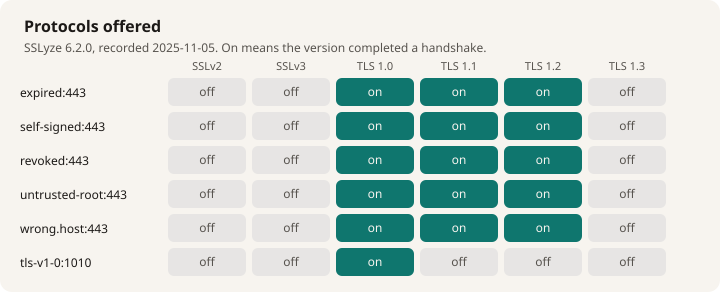
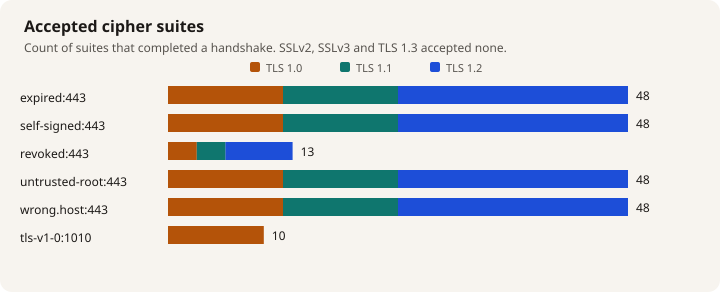
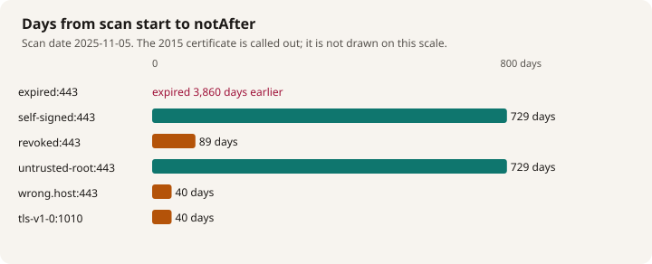
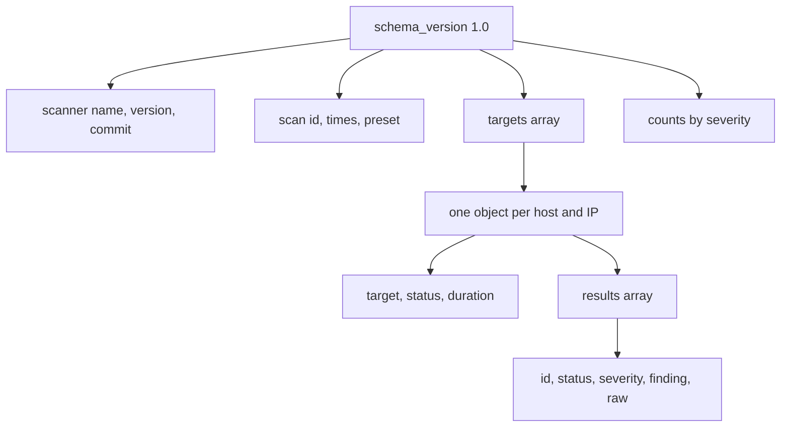
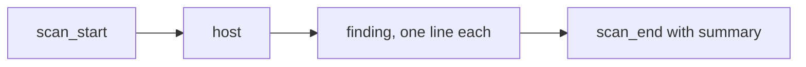

# Output

`certscan` will write one JSON document, or NDJSON. It does not write a terminal report. Version 0.1.0 does not scan, so the files below are a reading of published scans, not a run of this binary.

The scans are SSLyze 6.2.0 against the public [badssl.com](https://badssl.com/) testbed, recorded on 2025-11-05 and published by [secureCodeBox](https://github.com/secureCodeBox/secureCodeBox). Hashes and licenses are in [examples/SOURCES.md](examples/SOURCES.md).

Use the scanner only on systems you own or have permission to test.









| Host | Port | Handshake | Certificate fact in the source file |
|---|---|---|---|
| expired.badssl.com | 443 | TLS 1.2, `ECDHE-RSA-AES128-GCM-SHA256` | `notAfter` 2015-04-12. Path validation: not valid at validation time |
| self-signed.badssl.com | 443 | TLS 1.2, `ECDHE-RSA-AES128-GCM-SHA256` | Subject equals issuer. Path validation: missing required extension |
| revoked.badssl.com | 443 | TLS 1.2, `ECDHE-ECDSA-AES128-GCM-SHA256` | Path validation succeeded. The file has no OCSP response |
| untrusted-root.badssl.com | 443 | TLS 1.2, `ECDHE-RSA-AES128-GCM-SHA256` | Issuer is `BadSSL Untrusted Root Certificate Authority`. Path validation: missing required extension |
| wrong.host.badssl.com | 443 | TLS 1.2, `ECDHE-RSA-AES128-GCM-SHA256` | SAN is `*.badssl.com`, `badssl.com`. Path validation: no matching subjectAltName |
| tls-v1-0.badssl.com | 1010 | TLS 1.0, `ECDHE-RSA-AES256-SHA` | Only TLS 1.0 completed a handshake. Path validation succeeded on that date |

<details>
<summary>Document shape</summary>

A finished run is one JSON object. The writer is meant to stream it: header, then each `targets` element as that host finishes, then `summary`. NDJSON is the form to use for a long list, because a crashed process would otherwise leave the array unclosed.

`schema_version` is `MAJOR.MINOR`. New fields and new check ids are a minor change. Removing or renaming a field is a major change. A consumer ignores unknown fields.

The design record for this shape is section 8 of [ARCHITECTURE.md](ARCHITECTURE.md). On conflict, [DECISIONS.md](DECISIONS.md) wins. `cargo xtask schema` is declared and not implemented, so there is no generated JSON Schema in the tree yet.

The combined reading is [examples/certscan-1.0.json](examples/certscan-1.0.json). It carries `example_note` so a consumer can tell it from a future real run. `scanner.commit` is null: this repository did not execute the scan.

</details>

<details>
<summary>One target, reduced</summary>

This is the expired host, with the protocol results omitted. The full object is in the combined file.

```json
{
  "target": {
    "input": "expired.badssl.com:443",
    "host": "expired.badssl.com",
    "ip": "104.154.89.105",
    "ip_version": 4,
    "port": 443,
    "sni": "expired.badssl.com",
    "service": "http"
  },
  "status": "completed",
  "duration_ms": 38968,
  "results": [
    {
      "id": "cert.not_after",
      "testssl_id": "cert_expirationStatus",
      "group": "cert",
      "title": "Certificate validity",
      "status": "ok",
      "severity": "CRITICAL",
      "finding": "not valid at validation time; notAfter 2015-04-12T23:59:59Z",
      "raw": {
        "not_valid_before": "2015-04-09T00:00:00Z",
        "not_valid_after": "2015-04-12T23:59:59Z",
        "days_from_scan_start_to_not_after": -3860
      },
      "error": null
    }
  ]
}
```

`status` on a result is whether the check ran. `severity` is what it found. A failed check is `error` or `not_tested`, not `OK`.

Target status is one of `completed`, `partial`, `unreachable`, `not_tls`, `blocked_or_down`, `error`. Every host in this set connected, so each target is `completed`.

</details>

<details>
<summary>How these severities were assigned</summary>

This mapping is an illustration. It is not a decision in [DECISIONS.md](DECISIONS.md), and the rating described in section 9 of the design record is not implemented.

| Condition in the source file | Example severity | Why |
|---|---|---|
| `notAfter` before the scan start | `CRITICAL` | [testssl.sh's badssl test](https://github.com/testssl/testssl.sh/blob/87ecc1c9f2dac83a6be29f4461a47c2ac6afb906/t/51_badssl.com.t) expects `cert_expirationStatus` on `expired.badssl.com` to be `CRITICAL` and the finding to read expired. The finding text here is the SSLyze error, not a byte copy of testssl.sh |
| TLS 1.0 or TLS 1.1 offered | `INFO` | The fact is recorded. No severity for "offered" is ratified |
| TLS 1.2 or TLS 1.3 offered, or a version not offered | `OK` | Absence is `raw.offered: false`, not a higher severity |
| Path validation failed for a reason other than expiry | `INFO` | The finding is the source error string. It is not upgraded to `HIGH` |
| Path validation succeeded | `OK` | Includes `revoked.badssl.com` in this file. See the caveat below |
| Heartbleed bit false | `OK` | The source field `is_vulnerable_to_heartbleed` is false. `CVE-2014-0160` names the check. It is not a claim that the host is affected |

Counts in the example summary: 38 `OK`, 15 `INFO`, 1 `CRITICAL`. `LOW`, `MEDIUM` and `HIGH` are zero because this reading does not use them.

</details>

<details>
<summary>What the revoked file does not prove</summary>

[badssl.com](https://badssl.com/) advertises `revoked.badssl.com` as a revoked certificate. The published SSLyze file from 2025-11-05 does not contain that proof:

- path validation succeeded against the trust stores in the file
- `verified_certificate_chain` is present
- `ocsp_response` is null

A hostname is not a finding. The example therefore has no `cert.revoked` result. A later scan, or a testssl.sh run that did fetch OCSP, can disagree with this file. One published disagreement is [testssl.sh issue 2667](https://github.com/testssl/testssl.sh/issues/2667), where a 3.1dev run of the same hostname reported `cert_ocspRevoked` as `revoked`.

</details>

<details>
<summary>NDJSON</summary>

`--format ndjson-finding` is one JSON object per line. The line has `type`: `scan_start`, `host`, `finding`, or `scan_end`. A finding line also has `scan_id` and a short `target`. NDJSON is always compact. `--pretty` does not apply.



The sample stream is [examples/certscan-1.0.ndjson](examples/certscan-1.0.ndjson). It keeps non-OK findings, plus the Heartbleed line, so the file stays a format sample rather than a second copy of every OK protocol.

The first line, one finding, and the last line. The file has the host lines and the other findings between them. The `summary` below is the real last line.

```json
{"type":"scan_start","schema_version":"1.0","scan_id":"3f1c0a6e-7b24-4c1d-9a55-0b6e2f4a91d8","started_at":"2025-11-05T12:14:27Z"}
{"type":"finding","scan_id":"3f1c0a6e-7b24-4c1d-9a55-0b6e2f4a91d8","target":"expired.badssl.com:443","id":"cert.not_after","severity":"CRITICAL","finding":"not valid at validation time; notAfter 2015-04-12T23:59:59Z"}
{"type":"scan_end","scan_id":"3f1c0a6e-7b24-4c1d-9a55-0b6e2f4a91d8","finished_at":"2025-11-05T12:21:27Z","summary":{"targets_total":6,"targets_completed":6,"targets_failed":0,"by_severity":{"OK":38,"INFO":15,"LOW":0,"MEDIUM":0,"HIGH":0,"CRITICAL":1},"interrupted":false}}
```

`ndjson-host` is the other stream: one line per host, no per-finding lines. It is specified in the design record and not given a second sample here.

</details>

<details>
<summary>Flat testssl.sh array</summary>

`--format testssl-flat` is a JSON array. Each object has `id`, `ip`, `port`, `severity` and `finding`, plus `cve` or `cwe` when the check has them. That is the compatibility shape in section 8.3 of the design record.

The sample is [examples/testssl-flat.json](examples/testssl-flat.json). It is not byte-compatible with testssl.sh:

- exact ids are not verified yet, except `heartbleed` and `cert_expirationStatus`, which this reading copies where the source supports them
- finding strings are taken from the SSLyze file
- `not_tested` and `error` would be written as testssl severity `WARN`; this set has neither

`testssl-pretty` is a different document: run metadata plus `scanResult`, with findings grouped by section. No pretty sample is included. The golden files for that mode are a phase 4 task.

</details>

<details>
<summary>Fields the example leaves out</summary>

The source files do not record a connection count, a reverse DNS name, or a STARTTLS dialect. Those fields are omitted, not set to zero or to an empty string. Zero would mean "no connection", which is false: each scan connected.

`raw` holds the structured leftover: protocol offered or not, accepted-suite counts, certificate dates, trust-store names, and the SSLyze uuid and file hash under `source` on the target. The full cipher name lists stay in the upstream JSON. They are configuration inventory, linked from [SOURCES.md](examples/SOURCES.md), and are not copied here.

Exit codes are unchanged from the design record: 0 finished with nothing at or above `--fail-on`, 1 findings at or above that threshold, 2 bad arguments, 3 partial, 4 nothing reached, 5 output error, 130 interrupted. The 0.1.0 binary only implements the argument error: any host argument exits 2 and opens no connection.

</details>

<details>
<summary>Files</summary>

| File | What it is |
|---|---|
| [examples/published-extracts.json](examples/published-extracts.json) | Facts taken from the six SSLyze files |
| [examples/certscan-1.0.json](examples/certscan-1.0.json) | Those facts read into schema 1.0 |
| [examples/certscan-1.0.ndjson](examples/certscan-1.0.ndjson) | Finding stream for the same reading |
| [examples/testssl-flat.json](examples/testssl-flat.json) | Flat array shape, not a byte-compatible dump |
| [examples/SOURCES.md](examples/SOURCES.md) | Upstream URL, sha256, Apache-2.0 notice |
| [examples/charts/](examples/charts/) | The three figures above |

</details>
